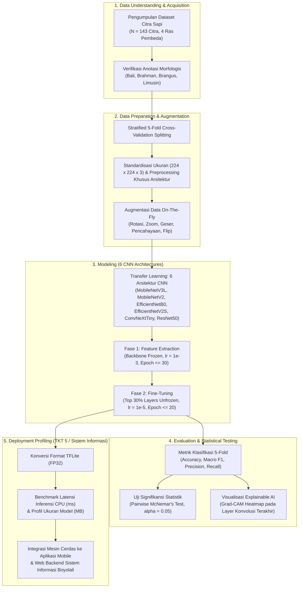
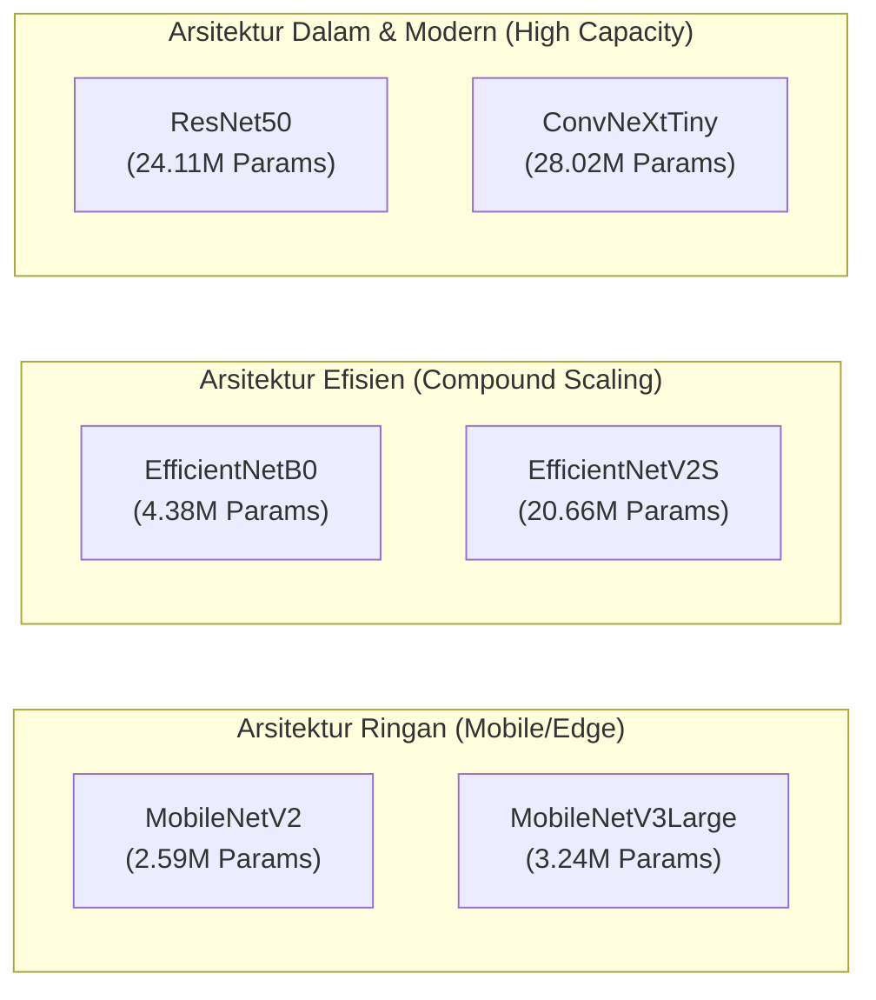

# BAB III: METODOLOGI PENELITIAN
## Komparasi Arsitektur Deep Learning dan Uji Kelayakan Edge Deployment untuk Klasifikasi Jenis Sapi

---

## 3.1 Kerangka Kerja Penelitian

Penelitian ini mengadopsi kerangka kerja standar industri **CRISP-DM (*Cross-Industry Standard Process for Data Mining*)** yang diadaptasi secara khusus untuk rekayasa visi komputer (*computer vision*) dan pembelajaran mendalam (*deep learning*). Pendekatan ini menghubungkan seluruh siklus hidup pengembangan sistem informasi peternakan Boyolali: berawal dari pemahaman kebutuhan lapangan (*Business Understanding*), pemahaman dan persiapan data citra (*Data Understanding & Preparation*), pemodelan komparatif multi-arsitektur (*Modeling*), pengujian statistik dan verifikasi visual (*Evaluation*), hingga penetapan mesin inferensi cerdas terbaik untuk integrasi aplikasi mobile Android luring (*offline-first*) dan sistem web backend (*Deployment*).

> 📊 **Berkas Diagram Vektor Draw.io:** [`assets/metodologi_crisp_dm.drawio`](./assets/metodologi_crisp_dm.drawio)



---

## 3.2 Karakteristik dan Spesifikasi Dataset

Objek data dalam penelitian ini adalah citra digital dari empat ras sapi potong dan introduksi unggulan yang memiliki nilai ekonomis strategis di Indonesia, khususnya di sentra peternakan Kabupaten Boyolali. Total sampel yang dikurasi berjumlah **143 citra** yang telah diverifikasi anotasi label rasnya.

### 3.2.1 Rasionalisasi Pemilihan 4 Ras dalam Peta Jalan 6 Ras Sistem Informasi
Peta jalan menyeluruh (*roadmap*) pengembangan sistem informasi peternakan Boyolali menargetkan enam jenis sapi (Sapi Jawa/PO, Sapi Madura, Sapi Bali, Sapi Brahman, Sapi Brangus, dan Sapi Limusin). Pada tahap komparasi model (*model comparing*) ini, investigasi difokuskan pada empat ras representatif yang telah terkurasi secara ketat ($N = 143$). Keempat ras ini dipilih karena merepresentasikan spektrum variasi morfologi fenotipik paling kontras dan komprehensif di lapangan:
1. *Subspesies Bos indicus* murni dengan ciri punuk (*hump*) dan lipatan gelambir leher (*dewlap*) ekstrem (Sapi Brahman).
2. *Subspesies Bos javanicus* dengan pola warna bulu khas, cermin hidung berbingkai putih (*white muzzle*), dan tungkai putih (*white socks*) (Sapi Bali).
3. *Ras komposit persilangan tropis* bertubuh tebal berotot, warna hitam legam seragam, dan tanpa tanduk (*polled*) (Sapi Brangus).
4. *Subspesies Bos taurus* tipe pedaging murni asal Eropa dengan punggung lurus dan massa otot padat tanpa punuk (Sapi Limusin).

Fokus pada empat ras pembeda ini berfungsi sebagai *benchmark testbed* yang ideal untuk menguji batas ketahanan fitur spasial masing-masing arsitektur CNN terhadap fitur morfologi ekstrem sebelum model diimplementasikan secara berkesinambungan pada ras lokal tambahan (Sapi Jawa dan Sapi Madura) seiring penyelesaian akuisisi data lapangan.

### 3.2.2 Sebaran Data per Ras Sapi
Distribusi kelas dijaga relatif berimbang (*balanced dataset*) untuk mencegah bias frekuensi mayoritas selama proses pembelajaran mesin:

| Ras Sapi | Jumlah Sampel ($N$) | Proporsi (%) | Karakteristik Fenotipik Utama yang Menjadi Pembeda Visual |
|---|---|---|---|
| **Sapi Bali** (*Bos javanicus domesticus*) | 34 | 23.78% | Warna bulu merah bata (betina/muda) atau hitam pekat (jantan dewasa), cermin hidung hitam berbingkai putih (*white muzzle*), kaki putih dari lutut ke bawah (*white socks*), dan bercak putih pada pantat (*mirror*). |
| **Sapi Brahman** (*Bos indicus*) | 33 | 23.08% | Punuk (*hump*) berukuran besar di atas bahu, lipatan gelambir leher (*dewlap*) yang longgar dan lebar, telinga panjang menggantung, serta warna bulu abu-abu keperakan hingga cokelat muda. |
| **Sapi Brangus** (*Brahman × Angus*) | 37 | 25.87% | Tubuh tebal berotot (*muscular*), tanpa tanduk (*polled*), punuk berukuran sedang/kecil, dan warna bulu seragam hitam legam tanpa bercak putih. |
| **Sapi Limusin** (*Bos taurus*) | 39 | 27.27% | Postur tubuh besar dan panjang, otot paha dan punggung sangat padat, warna bulu merah keemasan (*golden-red*) terang hingga cokelat gelap, tanpa punuk. |
| **Total** | **143** | **100.00%** | Resolusi masukan standar: $224 \times 224$ piksel, kanal warna RGB (3 kanal). |

---

## 3.3 Skema Validasi: Stratified 5-Fold Cross-Validation

Mengingat dataset berada pada rezim sampel terkurasi terbatas ($N = 143$), penggunaan pembagian data tunggal (*single train-test split*) memiliki risiko tinggi menghasilkan metrik performa yang semu atau bergantung pada keberuntungan pemisahan data (*sampling luck*).

Untuk menjamin keandalan ilmiah (*scientific reliability*) dan menghindari *overfitting*, penelitian ini menerapkan skema **Stratified 5-Fold Cross-Validation**:
1. Seluruh 143 citra dipartisi menjadi $K = 5$ subset (fold) berukuran seimbang ($\approx 28\text{--}29$ citra per fold).
2. Mekanisme *stratified* menjamin proporsi keempat kelas ras sapi tetap identik pada setiap lipatan data.
3. Pada setiap iterasi $k \in \{1, 2, 3, 4, 5\}$, sebanyak 4 fold ($\approx 114\text{--}115$ citra) difungsikan sebagai data latih (*training set*), dan 1 fold sisanya ($\approx 28\text{--}29$ citra) diisolasi sebagai data validasi/uji (*unseen validation set*).
4. Hasil akhir setiap model dilaporkan dalam bentuk **rerata dan standar deviasi (*Mean ± Std*)** di seluruh 5 fold.

---

## 3.4 Pra-pemrosesan dan Augmentasi Citra

### 3.4.1 Preprocessing Pipeline
Setiap citra melalui tahapan pra-pemrosesan deterministik sebelum masuk ke jaringan saraf:
- **Spatial Resizing:** Penyesuaian dimensi spasial menjadi resolusi seragam $224 \times 224$ piksel menggunakan interpolasi *bilinear*.
- **Architecture-Specific Normalization:** Citra dinormalisasi sesuai fungsi prapemrosesan bawaan masing-masing backbone ImageNet:
  - MobileNetV2 dan MobileNetV3: Penyekalaan nilai piksel ke rentang $[-1, 1]$.
  - EfficientNetB0 dan EfficientNetV2S: Penyekalaan otomatis sesuai standar EfficientNet.
  - ResNet50: Konversi RGB ke BGR dengan pengurangan nilai rata-rata kanal ImageNet (*zero-centering* tanpa penskalaan).
  - ConvNeXtTiny: Normalisasi z-score berbasis deviasi standar ImageNet.

### 3.4.2 Augmentasi Data On-The-Fly
Untuk meningkatkan invariansi model terhadap variasi kondisi pemotretan di kandang peternakan terbuka (perbedaan sudut kamera, pencahayaan, dan jarak), generator data latih mengaplikasikan augmentasi geometri dan fotometrik dinamis:
- *Random Horizontal Flip*: Probabilitas $0.5$ (simetri tubuh ternak).
- *Random Rotation Range*: Rentang rotasi sudut $\pm 25^\circ$.
- *Width & Height Shift*: Pergeseran translasi hingga $10\%$ dimensi gambar.
- *Shear Range*: Transformasi geser sebesar $10\%$.
- *Zoom Range*: Pembesaran/pengecilan acak sebesar $20\%$ (faktor skala $0.8\text{--}1.2$).
- *Brightness Range*: Variasi intensitas pencahayaan antara $80\%$ hingga $120\%$.
- *Fill Mode*: `nearest` untuk mengisi piksel kosong akibat transformasi geometris.

---

## 3.5 Arsitektur Deep Learning yang Dikomparasikan

Eksperimen membandingkan enam arsitektur Convolutional Neural Network (CNN) modern yang merepresentasikan tiga kelompok paradigma arsitektural:

> 📊 **Berkas Diagram Vektor Draw.io:** [`assets/taksonomi_arsitektur_cnn.drawio`](./assets/taksonomi_arsitektur_cnn.drawio)



1. **MobileNetV3Large** (*Howard et al., 2019*): Model ringan hasil optimasi *Hardware-Aware Neural Architecture Search* (NAS) dan NetAdapt, memanfaatkan fungsi aktivasi *hard-swish* dan blok *Squeeze-and-Excitation* (SE) untuk inferensi gesit pada perangkat seluler.
2. **MobileNetV2** (*Sandler et al., 2018*): Pelopor struktur *Inverted Residuals* dengan *Linear Bottlenecks* yang meminimalkan kehilangan informasi non-linear pada saluran sempit.
3. **EfficientNetB0** (*Tan & Le, 2019*): Model skala berimbang yang mengoptimalkan kedalaman (*depth*), lebar kanal (*width*), dan resolusi citra secara simultan menggunakan koefisien kompon (*compound scaling*).
4. **EfficientNetV2S** (*Tan & Le, 2021*): Evolusi arsitektur dengan *Fused-MBConv* yang meniadakan operasi *depthwise* pada layer awal untuk percepatan komputasi GPU/TPU serta mendukung pelatihan progresif.
5. **ConvNeXtTiny** (*Liu et al., 2022*): Modernisasi arsitektur murni konvolusi (*pure CNN*) yang mengadopsi prinsip desain Vision Transformer (ViT), seperti patch konvolusi berukuran $7 \times 7$, *Layer Normalization*, dan aktivasi GELU.
6. **ResNet50** (*He et al., 2016*): Arsitektur residual klasik berbasis *identity shortcut connections* yang menjadi standar baku literatur visi komputer untuk mencegah degradasi gradien pada jaringan dalam.

### Struktur Classification Head Terpadu
Untuk menjaga keadilan komparasi (*controlled experiment*), seluruh model menggunakan struktur *classification head* yang identik:
$$\text{Backbone} \longrightarrow \text{GlobalAveragePooling2D} \longrightarrow \text{Dense}(256, \text{ReLU}) \longrightarrow \text{Dropout}(p=0.3) \longrightarrow \text{Dense}(4, \text{Softmax})$$

---

## 3.6 Protokol Pelatihan 2-Fase (*Two-Phase Transfer Learning*)

Pelatihan model dilaksanakan menggunakan dua tahapan transfer learning yang ketat untuk mengoptimalkan konvergensi bobot:

```
[Inisialisasi Bobot Pretrained ImageNet]
                   │
                   ▼
┌────────────────────────────────────────────────────────┐
│ FASE 1: FEATURE EXTRACTION                             │
│ • Backbone: Dibekukan sepenuhnya (trainable = False)   │
│ • Target Latih: Hanya bobot Classification Head        │
│ • Optimizer: Adam (Learning Rate = 1e-3)               │
│ • Durasi: Maksimum 30 Epoch, Batch Size = 16           │
│ • Callbacks: EarlyStopping (Patience=5 pada val_loss)  │
└────────────────────────────────────────────────────────┘
                   │
                   ▼
┌────────────────────────────────────────────────────────┐
│ FASE 2: FINE-TUNING                                    │
│ • Backbone: Unfreeze 30% layer konvolusi teratas       │
│ • Batch Normalization: Tetap dibekukan (stabilitas)    │
│ • Optimizer: Adam (Learning Rate = 1e-5 / 100x kecil)  │
│ • Durasi: Maksimum 20 Epoch, Batch Size = 16           │
│ • Callbacks: EarlyStopping (Patience=5) + ReduceLR     │
└────────────────────────────────────────────────────────┘
```

Fungsi kerugian (*loss function*) yang dioptimalkan pada kedua fase adalah *Categorical Cross-Entropy*:
$$\mathcal{L}_{CCE} = -\sum_{i=1}^{C} y_i \log(\hat{y}_i)$$
di mana $C = 4$ adalah jumlah kelas ras sapi, $y_i$ merupakan ground-truth one-hot vector, dan $\hat{y}_i$ adalah probabilitas tingkat keyakinan yang diprediksi oleh fungsi Softmax.

---

## 3.7 Metrik Evaluasi Performa

Evaluasi model dilakukan secara komprehensif mencakup metrik agregat global dan metrik spesifik per-kelas ras sapi:

1. **Akurasi (*Accuracy*):**
   $$\text{Accuracy} = \frac{TP + TN}{TP + TN + FP + FN}$$
2. **Presisi Makro (*Macro-Averaged Precision*):**
   $$\text{Precision}_{\text{macro}} = \frac{1}{C}\sum_{c=1}^{C}\frac{TP_c}{TP_c + FP_c}$$
3. **Recall Makro (*Macro-Averaged Recall*):**
   $$\text{Recall}_{\text{macro}} = \frac{1}{C}\sum_{c=1}^{C}\frac{TP_c}{TP_c + FN_c}$$
4. **F1-Score Makro (*Macro-Averaged F1-Score*):**
   $$\text{F1}_{\text{macro}} = 2 \times \frac{\text{Precision}_{\text{macro}} \times \text{Recall}_{\text{macro}}}{\text{Precision}_{\text{macro}} + \text{Recall}_{\text{macro}}}$$
5. **Metrik Individual per-Ras:** Presisi, Recall, dan F1-Score dihitung untuk tiap kelas (Bali, Brahman, Brangus, Limusin) guna mendeteksi ada tidaknya bias terhadap ras tertentu.
6. **Aggregated Confusion Matrix:** Matriks konfusi diakumulasikan dari prediksi data uji seluruh $K=5$ fold, sehingga merefleksikan seluruh 143 citra tanpa duplikasi.

---

## 3.8 Uji Signifikansi Statistik: McNemar's Test

Untuk membuktikan apakah perbedaan performa antar-arsitektur memiliki signifikansi statistik atau hanya terjadi secara kebetulan akibat variasi sampel, diterapkan **Uji McNemar Berpasangan (*Pairwise McNemar's Test*)**. 

Uji McNemar beroperasi pada tabel kontingensi $2 \times 2$ berdasarkan ketepatan klasifikasi kedua model pada sampel data yang sama:

| | Model B Benar | Model B Salah |
|---|---|---|
| **Model A Benar** | $a$ (keduanya benar) | $b$ (A benar, B salah) |
| **Model A Salah** | $c$ (A salah, B benar) | $d$ (keduanya salah) |

Statistik uji dihitung menggunakan koreksi kontinuitas Edwards:
$$\chi^2 = \frac{(|b - c| - 1)^2}{b + c}, \quad \text{derajat kebebasan } (df) = 1$$

- **Hipotesis Nol ($H_0$):** Model A dan Model B memiliki tingkat kesalahan klasifikasi (*disagreement rate*) yang sama.
- **Tingkat Signifikansi ($\alpha$):** $0.05$. Jika nilai $p < 0.05$, $H_0$ ditolak (perbedaan performa signifikan secara statistik).

---

## 3.9 Explainable AI: Grad-CAM (*Gradient-Weighted Class Activation Mapping*)

Untuk memastikan model tidak terpengaruh fenomena *Clever Hans* (membuat prediksi benar berdasarkan objek latar belakang seperti rumput, pagar kandang, atau tanah), diterapkan metode interpretasi visual **Grad-CAM**.

Grad-CAM menghitung gradien skor kelas target $y^c$ terhadap peta fitur aktivasi $A^k$ pada layer konvolusi terakhir sebelum Global Average Pooling:
$$\alpha_k^c = \frac{1}{Z} \sum_{i} \sum_{j} \frac{\partial y^c}{\partial A_{i,j}^k}$$
Peta lokalisasi visual diperoleh melalui kombinasi linier terbobot yang dilewatkan pada fungsi rektifikasi ReLU:
$$L_{\text{Grad-CAM}}^c = \text{ReLU}\left(\sum_k \alpha_k^c A^k\right)$$

Peta panas (*heatmap*) dinormalisasi ke rentang $[0, 1]$ dan ditumpangkan (*overlay*) ke atas citra asli menggunakan colormap `jet` untuk memvisualisasikan bagian anatomi sapi yang menjadi fokus atensi model.

---

## 3.10 Evaluasi Kelayakan Komputasi Tepi (*Edge Deployment Feasibility*)

Sesuai target kesiapterapan teknologi **TKT 5 (Validasi prototipe dalam lingkungan relevan)** dan integrasi ke dalam aplikasi mobile **SapiKenal**:
1. **Model Quantization / Serialization:** Seluruh checkpoint model terbaik (`.keras`) dikonversi ke format **TensorFlow Lite (`.tflite`)** dengan presisi FP32.
2. **Ukuran Berkas (*Footprint Size*):** Diukur dalam satuan MegaByte (MB) untuk menilai beban instalasi aplikasi pada penyimpanan ponsel peternak.
3. **Pengukuran Latensi Riil (*CPU Inference Latency*):**
   - Diuji menggunakan `tf.lite.Interpreter` pada lingkungan CPU multi-core.
   - Dijalankan sebanyak **110 iterasi inferensi** per model.
   - Sebanyak 10 iterasi awal dibuang sebagai fase pemanasan (*warmup*).
   - Rerata durasi inferensi dihitung dari 100 iterasi sisanya dalam satuan milidetik (ms).

---

## 3.11 Lingkungan Komputasi dan Perangkat Keras

Eksperimen komparasi dijalankan secara terisolasi pada infrastruktur komputasi awan (*cloud environment*) dengan spesifikasi:
- **Akselerator Grafis (GPU):** NVIDIA Tesla T4 (15 GB VRAM GDDR6).
- **Prosesor Host:** Intel Xeon @ 2.20GHz (2 vCPU, RAM 13 GB).
- **Sistem Operasi:** Linux Ubuntu 22.04 LTS (x86_64).
- **Perangkat Lunak Utama:**
  - Python 3.10.12
  - TensorFlow / Keras 2.15+
  - Scikit-Learn 1.2+
  - OpenCV, Pandas, Matplotlib, Seaborn
  - Roboflow SDK untuk penanganan dataset tersinkronisasi.
