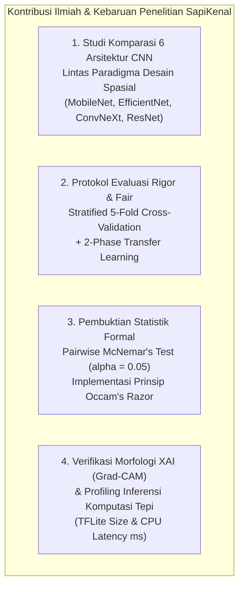

# BAB I: PENDAHULUAN
## Latar Belakang, Tinjauan Permasalahan, dan Kebaruan Penelitian

---

## 1.1 Latar Belakang dan Urgensi Masalah

Sektor peternakan sapi memegang peranan krusial dalam memperkuat ketahanan pangan hewani nasional dan menopang perekonomian masyarakat pedesaan di Indonesia. Kabupaten Boyolali, Provinsi Jawa Tengah, secara luas diakui sebagai salah satu lumbung dan sentra peternakan sapi terkemuka di Pulau Jawa. Populasi sapi di wilayah ini mencakup puluhan ribu ekor yang tersebar di sentra peternakan rakyat dan pasar-pasar hewan regional, mencakup sapi perah maupun sapi potong unggulan.

Setiap ras atau jenis sapi memiliki karakteristik fenotipik, fisiologis, dan produktivitas yang berbeda secara signifikan. Di tingkat nasional maupun di Kabupaten Boyolali, terdapat enam ras sapi yang menjadi fokus strategis dalam tata kelola peternakan, mencakup ras lokal adaptif (Sapi Jawa/PO, Sapi Madura, dan Sapi Bali) serta ras potong introduksi unggulan berdaya hasil tinggi (Sapi Brahman, Sapi Brangus, dan Sapi Limusin). Karakteristik biologis masing-masing ras mencakup:
- **Sapi Bali** (*Bos javanicus domesticus*) dikenal memiliki persentase karkas tinggi, daya adaptasi tinggi terhadap pakan berserat kasar, serta tingkat fertilitas yang luar biasa.
- **Sapi Brahman** (*Bos indicus*) memiliki ketahanan tinggi terhadap paparan panas tropis dan ektoparasit berkat keberadaan punuk (*hump*) dan gelambir leher (*dewlap*) yang luas.
- **Sapi Brangus** (persilangan Brahman × Aberdeen Angus) menggabungkan keunggulan ketahanan iklim tropis dengan laju pertambahan bobot badan harian (*Average Daily Gain* / ADG) yang pesat serta kualitas daging tanpa lemak.
- **Sapi Limusin** (*Bos taurus*) merupakan ras tipe besar asal Eropa dengan pertumbuhan otot yang sangat cepat dan hasil karkas daging bernilai ekonomis tinggi.
- **Sapi Jawa (Peranakan Ongole / PO)** dan **Sapi Madura** yang menjadi penopang utama peternakan rakyat berkat daya tahan luar biasa terhadap iklim lokal dan efisiensi pemanfaatan pakan berserat.

Perbedaan biologis dan genetik ini secara langsung menentukan **strategi pemeliharaan, formulasi ransum pakan, manajemen penggemukan, hingga penaksiran harga jual ternak di pasar hewan**. Kesalahan dalam mengidentifikasi jenis sapi dapat menimbulkan dampak berantai, antara lain kerugian finansial akibat kekeliruan taksiran bobot karkas, ketidakefektifan formulasi nutrisi pakan, hingga terhambatnya program pemuliaan genetik (*genetic breeding*) untuk menghasilkan bibit ternak unggul.

---

## 1.2 Permasalahan Identifikasi Konvensional

Meskipun klasifikasi jenis sapi memiliki nilai ekonomis yang sangat strategis, praktik identifikasi di tingkat peternak rakyat dan pasar hewan tradisional saat ini masih mengandalkan **pengamatan visual konvensional secara subjektif**. Para peternak dan pedagang hewan umumnya mengenali sapi hanya berdasarkan pengamatan sekilas terhadap bentuk punuk, warna bulu, lipatan gelambir, atau postur tubuh ternak.

Metode konvensional ini memiliki sejumlah kelemahan mendasar:
1. **Tingginya Subjektivitas dan Bias Pengamat:** Identifikasi sangat bergantung pada pengalaman empiris perorangan yang sulit distandardisasi. Peternak pemula atau penyuluh peternakan seringkali kesulitan membedakan ras murni dengan ras hasil persilangan silang (*crossbreed*) yang memiliki kemiripan morfologis fenotipik.
2. **Kemiripan Ciri Fenotipe Antar-Ras:** Pada kondisi tertentu—seperti masa pertumbuhan sapi muda atau sapi betina—gradasi warna bulu dan struktur postur antara Sapi Bali betina dengan Sapi Limusin muda menunjukkan kemiripan visual yang rentan memicu misklasifikasi.
3. **Ketiadaan Rekam Jejak Digital yang Objektif:** Tidak adanya sistem pencatatan berbasis citra digital menyebabkan data persebaran populasi ternak dan transaksi jual beli di sentra peternakan Boyolali sulit divalidasi secara saintifik.

---

## 1.3 Peluang Pembelajaran Mendalam (*Deep Learning*), Sistem Informasi, dan Tantangan Komputasi Tepi (*Edge Computing*)

Perkembangan teknologi visi komputer (*computer vision*) berbasis pembelajaran mendalam (*deep learning*), khususnya arsitektur Convolutional Neural Network (CNN), menawarkan peluang besar untuk mentransformasi identifikasi jenis sapi menjadi proses komputasi yang objektif, otomatis, dan akurat. Di sisi lain, kemajuan rekayasa perangkat lunak memungkinkan pengintegrasian model kecerdasan buatan tersebut ke dalam **sistem informasi terpadu (berbasis web dan aplikasi bergerak / mobile)** yang dapat memfasilitasi pencatatan digital populasi ternak, validasi transaksi di pasar hewan, serta diseminasi informasi bagi peternak dan penyuluh di lapangan.

Kendati demikian, penerapan modul inferensi *deep learning* ke dalam sistem informasi pada skenario nyata peternakan rakyat di pedesaan Boyolali menghadapi **kendala infrastruktur dan komputasi yang nyata**:
1. **Keterbatasan Konektivitas Jaringan Internet:** Mayoritas kandang peternakan dan pasar hewan di pedesaan Boyolali berada pada area dengan sinyal internet yang tidak stabil atau bahkan tanpa jangkauan jaringan (*blind spot*). Situasi ini menuntut subsistem bergerak (*mobile*) yang mengusung paradigma **luring mandiri (*offline-first*)**, di mana inferensi klasifikasi citra harus dieksekusi secara lokal pada perangkat bergerak (*mobile device*).
2. **Keterbatasan Sumber Daya Perangkat Seluler:** Mayoritas peternak menggunakan ponsel pintar berspesifikasi menengah ke bawah (*low-to-mid range Android devices*) dengan kapasitas memori RAM terbatas dan tanpa akselerator grafis (GPU) khusus.
3. **Dilema Trade-off Akurasi vs Efisiensi:** Model berkapasitas besar (seperti ResNet50 atau varian Vision Transformer) memang dikenal memiliki akurasi tinggi pada server komputasi awan. Namun, model berbobot puluhan juta parameter tersebut menghasilkan ukuran berkas instalasi yang sangat besar ($>90\text{ MB}$) dan latensi inferensi CPU yang tinggi ($>100\text{ ms}$), yang dapat menyebabkan *freeze*, konsumsi baterai boros, dan kegagalan responsivitas aplikasi di lapangan.

Oleh karena itu, diperlukan penyelidikan ilmiah yang ketat untuk menemukan arsitektur *deep learning* yang menempati titik keseimbangan optimal (*Pareto frontier / sweet spot*): **memiliki akurasi klasifikasi prima sekaligus berukuran ringkas dan berlatensi sangat rendah pada komputasi tepi CPU**, sebagai mesin inferensi inti (*core engine*) bagi sistem informasi peternakan yang andal.

---

## 1.4 Tinjauan Studi Terdahulu dan Kesenjangan Penelitian (*Research Gap*)

Pemanfaatan visi komputer dalam sektor peternakan cerdas (*precision livestock farming*) telah menjadi topik penelitian aktif dalam beberapa tahun terakhir:
- **Identifikasi Individual dan Wajah Sapi:** Qiao dkk. (2020) mengembangkan kerangka kerja kombinasi CNN dan LSTM untuk identifikasi sapi secara individual berdasarkan urutan video. Weng dkk. (2022) mengusulkan model *Two-Branch CNN* untuk pengenalan wajah sapi perah. Namun, penelitian-penelitian tersebut berfokus pada pengenalan individu (*individual biometric tracking*) pada peternakan modern berskala industri dengan setup kamera statis, bukan pada klasifikasi jenis/ras sapi di peternakan rakyat.
- **Klasifikasi Ras Ternak:** de Lima Weber dkk. (2020) menguji model CNN untuk mengenali ras sapi Pantaneira dari berbagai sudut pemotretan. Studi BharatPashu di India (2024) mengevaluasi model EfficientNet-B3 untuk identifikasi ras sapi Zebu dengan akurasi 82.55%. Di Indonesia, beberapa penelitian awal telah menguji MobileNetV2 dan ResNet50 untuk ras lokal, namun umumnya hanya menggunakan pembagian data tunggal (*single split*) pada dataset yang sangat kecil tanpa validasi statistik silang (*k-fold cross-validation*).

Berdasarkan tinjauan literatur di atas, teridentifikasi sejumlah **kesenjangan penelitian (*research gaps*)** yang belum terjawab:
1. **Ketiadaan Komparasi Lintas Paradigma Arsitektur yang Komprehensif:** Belum ada studi komparatif sistematis yang membandingkan arsitektur CNN ringan berbasis Neural Architecture Search (*MobileNetV3Large*), arsitektur skala kompon (*EfficientNetB0, EfficientNetV2S*), arsitektur residual klasik (*ResNet50*), dan arsitektur konvolusi modern berdesain Vision Transformer (*ConvNeXtTiny*) secara setara (*controlled protocol*) pada domain klasifikasi ras sapi Indonesia.
2. **Kurangnya Uji Signifikansi Statistik Formal:** Sebagian besar literatur sebelumnya mengklaim suatu model "lebih baik" hanya berdasarkan selisih persentase akurasi nominal, tanpa melakukan pengujian signifikansi statistik formal (seperti uji McNemar) untuk membuktikan apakah peningkatan tersebut nyata secara ilmiah atau sekadar fluktuasi acak.
3. **Ancaman Bias Latar Belakang (*Clever Hans Effect*):** Belum banyak penelitian klasifikasi ternak lokal yang menyertakan analisis *Explainable AI* (XAI) berbasis Grad-CAM untuk membuktikan bahwa model benar-benar membedakan sapi berdasarkan fitur anatomi morfologis biologis, bukan mengeksploitasi bias visual latar belakang kandang, rumput, atau pagar.
4. **Ketiadaan Profiling Deployment Riil:** Jarang ditemukan penelitian akademik yang mengukur metrik inferensi riil pada format komputasi tepi (TensorFlow Lite FP32) dan latensi CPU per-milidetik sebagai acuan implementasi aplikasi mobile peternak di lapangan.

---

## 1.5 Kebaruan dan Kontribusi Penelitian (*Novelty & Contributions*)

Untuk menjembatani kesenjangan penelitian tersebut dan mendukung pengembangan arsitektur sistem informasi peternakan terpadu (berbasis web dan aplikasi mobile **SapiKenal**) pada tingkat kesiapterapan teknologi **TKT 5**, penelitian ini memposisikan diri sebagai riset penentu mesin inferensi cerdas (*core intelligent engine selection*). Dalam peta jalan (*roadmap*) jangka panjang penelitian yang menargetkan enam jenis sapi di Kabupaten Boyolali (Sapi Jawa, Madura, Bali, Brahman, Brangus, dan Limusin), studi komparasi model pada tahap ini difokuskan pada **empat ras representatif dengan disparitas morfologi fenotipik paling kontras** (Bali, Brahman, Brangus, dan Limusin) sebagai tolok ukur ketahanan representasi visual arsitektur CNN sebelum ekspansi ke ras lokal Jawa dan Madura. Penelitian ini menyajikan empat kontribusi ilmiah utama:

> 📊 **Berkas Diagram Vektor Draw.io:** [`assets/kebaruan_penelitian.drawio`](./assets/kebaruan_penelitian.drawio)

1. **Komparasi Multi-Arsitektur Multi-Paradigma:** Melakukan studi komparatif terstandarisasi terhadap enam arsitektur CNN terkemuka (MobileNetV3Large, MobileNetV2, EfficientNetB0, EfficientNetV2S, ConvNeXtTiny, dan ResNet50) menggunakan protokol pelatihan dua fase (*feature extraction* dan *fine-tuning* terkalibrasi) pada citra ras sapi unggulan di Boyolali untuk menetapkan arsitektur terbaik bagi modul sistem informasi.
2. **Validasi Reliabilitas dengan Stratified 5-Fold Cross-Validation:** Menjamin seluruh 143 citra terkurasi dievaluasi secara independen tanpa risiko *sampling bias*, dengan pelaporan metrik *Mean ± Std* serta metrik per-kelas yang presisi pada empat ras pembeda utama.
3. **Penerapan Uji Signifikansi McNemar:** Memberikan landasan statistik empiris bahwa model berbobot puluhan juta parameter tidak memiliki keunggulan performa yang signifikan ($p > 0.05$) dibanding model ringan, sehingga menegakkan prinsip keilmuan *Occam's Razor* dalam pemilihan model produksi sistem informasi.
4. **Validasi Morfologis XAI dan Kesiapan Edge AI (TKT 5):** Menyajikan visualisasi Grad-CAM untuk membuktikan model mengunci atensi pada ciri anatomi khas ras (punuk Brahman, moncong Bali, otot Brangus, profil Limusin) sekaligus membuktikan kelayakan inferensi *real-time* ($11.40\text{ ms}$) dan ukuran hemat ($12.30\text{ MB}$) untuk integrasi aplikasi mobile *SapiKenal* secara luring (*offline-first*) maupun backend web sistem informasi.

---

## 1.6 Tujuan Penelitian

Sesuai dengan rumusan masalah dan roadmap penelitian hibah PUP Polines, tujuan penelitian ini adalah:
1. Menganalisis dan membandingkan performa klasifikasi citra dari enam arsitektur CNN modern dalam mengidentifikasi empat ras sapi unggulan representatif (Bali, Brahman, Brangus, dan Limusin) sebagai basis pemilihan model cerdas terbaik bagi sistem informasi peternakan Boyolali.
2. Membuktikan secara statistik menggunakan uji McNemar apakah penambahan parameter model menghasilkan perbedaan performa klasifikasi yang signifikan secara saintifik.
3. Menginterpretasikan representasi visual model terbaik menggunakan Grad-CAM guna memverifikasi keterkaitan atensi fitur dengan morfologi biologis ternak dan ketiadaan bias latar belakang kandang.
4. Mengukur efisiensi komputasi tepi (ukuran berkas TFLite dan latensi inferensi CPU) untuk menetapkan arsitektur terbaik yang siap dideploy pada aplikasi mobile peternak *SapiKenal* maupun diintegrasikan ke sistem informasi berbasis web.
