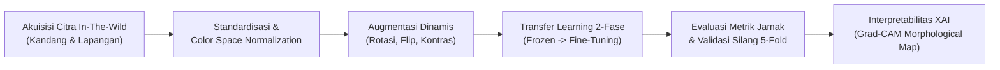
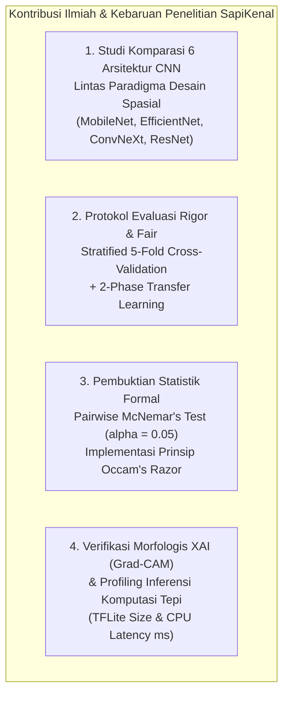
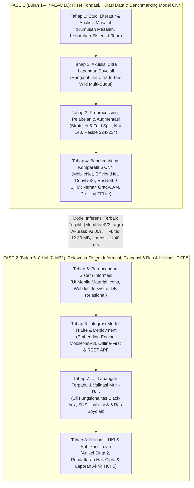

# BAB II: TINJAUAN PUSTAKA DAN PETA JALAN PENELITIAN
## Landasan Teori, Telaah Pustaka Mutakhir, dan Road Map Penelitian SapiKenal

---

## 2.1 Kajian Pustaka (*Literature Review*)

### 2.1.1 Sistem Informasi Peternakan Digital
Sistem informasi didefinisikan secara komprehensif sebagai suatu keterpaduan komponen yang terorganisasi—mencakup perangkat keras (*hardware*), perangkat lunak (*software*), infrastruktur jaringan, basis data (*database*), prosedur operasional, dan sumber daya manusia—yang berinteraksi secara sistematis untuk mengumpulkan, mengolah, menyimpan, menganalisis, dan mendiseminasikan data menjadi informasi yang bernilai guna bagi pengambilan keputusan manajerial maupun operasional [24]. Dalam era industri pertanian dan peternakan cerdas (*precision livestock farming* / Smart Farming 4.0), peranan sistem informasi telah bertransformasi dari sekadar repositori pencatatan administratif manual menjadi tulang punggung digitalisasi rantai pasok agribisnis ternak ruminansia.

Di Indonesia, khususnya pada ekosistem peternakan rakyat, pengelolaan data populasi ternak selama berpuluh-puluh tahun masih dilakukan secara konvensional berbasis formulir kertas atau rekaman memori subjektif peternak. Pendekatan konvensional ini memiliki kerentanan tinggi terhadap kehilangan data riwayat perkawinan silang (*crossbreeding records*), ketidakakuratan taksiran bobot badan, serta lambatnya respons terhadap pemantauan produktivitas ternak di tingkat daerah. Pemanfaatan sistem informasi peternakan terintegrasi menjadi urgensi strategis untuk mendukung pencatatan identitas ternak secara digital (*digital livestock registration*), memetakan sebaran ras unggulan, mencatat riwayat pemeliharaan, serta menstandardisasi transaksi jual beli di pasar-pasar hewan regional [1], [2].

Kendati demikian, implementasi sistem informasi pada domain peternakan pedesaan menghadapi kendala mendasar terkait infrastruktur teknologi informasi. Mayoritas kandang peternakan rakyat dan sentra pasar hewan tradisional terletak di wilayah pedesaan atau lereng pegunungan dengan topografi berbukit, di mana konektivitas internet seluler seringkali tidak stabil atau bahkan mengalami ketiadaan sinyal (*blind spot*). Oleh sebab itu, arsitektur sistem informasi modern yang dikembangkan dalam penelitian ini mengadopsi paradigma **luring mandiri (*offline-first architecture*)**. Pada paradigma ini, modul inferensi komputasi cerdas (*intelligent inference engine*) ditanamkan secara lokal pada perangkat bergerak (*mobile device*) pengguna, sehingga fungsi pencatatan data dan identifikasi visual ternak dapat dieksekusi secara instan tanpa ketergantungan pada koneksi jaringan internet aktif. Ketika perangkat kembali terhubung ke jaringan internet yang stabil, modul sinkronisasi otomatis (*background data synchronizer*) akan memperbarui data lokal ke server pusat atau portal web sistem informasi peternakan daerah secara aman dan konsisten [9].

Dalam rancang bangun sistem informasi terpadu **SapiKenal**, modul visi komputer berbasis *deep learning* memegang peranan krusial sebagai subsistem penentu (*core decision engine*). Alur pemrosesan sistem dimulai dari penangkapan citra digital sapi oleh kamera perangkat bergerak pengguna (peternak atau petugas penyuluh lapangan). Citra tersebut kemudian diekstraksi dan diklasifikasikan secara luring oleh model cerdas ke dalam salah satu ras sapi target, menghasilkan luaran berupa label jenis sapi beserta nilai tingkat keyakinan (*confidence score*). Metadata hasil klasifikasi—meliputi jenis sapi, estimasi morfologi, koordinat geografis (GPS), dan waktu identifikasi—secara otomatis diarsip ke dalam basis data lokal *SQLite/Room* pada perangkat mobile, sebelum direplikasi ke basis data relasional server web melalui antarmuka pemrograman aplikasi (RESTful API). Melalui integrasi ini, sistem informasi tidak hanya menyajikan data tekstual pasif, melainkan menyediakan kemampuan analitik preskriptif dan kognitif yang memvalidasi keaslian ras ternak secara saintifik di lapangan.

---

### 2.1.2 Perkembangan Deep Learning dan Visi Komputer
*Deep learning* (pembelajaran mendalam) merupakan cabang mutakhir dari kecerdasan buatan (*artificial intelligence*) dan pembelajaran mesin (*machine learning*) yang memanfaatkan representasi jaringan saraf tiruan berlapis banyak (*deep artificial neural networks*) untuk mempelajari representasi hierarkis fitur secara otomatis dari data mentah (*end-to-end feature learning*) [25]. Berbeda secara mendasar dengan metode pembelajaran mesin klasik yang sangat bergantung pada tahap rekayasa fitur manual (*hand-crafted features*)—seperti *Histogram of Oriented Gradients* (HOG), *Scale-Invariant Feature Transform* (SIFT), atau *Local Binary Patterns* (LBP) yang rentan mengalami penurunan performa drastis ketika dihadapkan pada variasi pencahayaan ekstrem, perubahan sudut pandang pemotretan, dan oklusi latar belakang—jaringan *deep learning* mampu mengekstraksi representasi fitur secara bertingkat: mulai dari fitur spasial berfrekuensi tinggi pada lapisan awal (garis tepi, sudut, dan tekstur mikro) hingga abstraksi semantik tingkat tinggi pada lapisan terdalam (proporsi punuk, bentuk kepala, lipatan gelambir, dan kontur postur tubuh ternak) [6], [25].

Dalam bidang visi komputer (*computer vision*), arsitektur Convolutional Neural Network (CNN) telah menjadi paradigma dominan untuk tugas-tugas visual seperti klasifikasi citra, segmentasi semantik, dan deteksi objek. Perkembangan arsitektur CNN selama satu dekade terakhir merefleksikan eksplorasi mendalam terhadap keseimbangan antara kedalaman representasi (*representational depth*), kapasitas parameter (*parameter capacity*), dan efisiensi komputasi (*computational efficiency*). Dalam lanskap komparasi model modern, terdapat empat paradigma arsitektur CNN utama yang mewakili evolusi keilmuan visi komputer:

1. **Paradigma Koneksi Residual Klasik (*Deep Residual Learning*):**
   Diperkenalkan oleh He dkk. melalui arsitektur ResNet (seperti ResNet50) [22], paradigma ini merevolusi pelatihan jaringan saraf sangat dalam dengan memperkenalkan koneksi pintas identitas (*identity shortcut connections* atau *residual skip connections*). Konsep formulasi residual $F(x) = H(x) - x$ secara efektif memecahkan permasalahan hilangnya gradien (*vanishing gradient problem*) dan degradasi optimasi saat lapisan jaringan diperdalam hingga puluhan atau ratusan lapis. ResNet50 menggunakan blok *bottleneck* $1\times 1 \to 3\times 3 \to 1\times 1$ konvolusi dengan total sekitar 25.6 juta parameter, menjadikannya arsitektur tolok ukur (*baseline benchmark*) yang sangat stabil dan kokoh untuk generalisasi representasi visual skala besar.

2. **Paradigma Komputasi Bergerak dan Komputasi Tepi (*Mobile & Edge-Optimized Architecture*):**
   Untuk mengatasi keterbatasan komputasi pada perangkat bergerak (*mobile devices*), Sandler dkk. merancang arsitektur MobileNetV2 [18] yang memperkenalkan struktur *Inverted Residual Block* dengan *Linear Bottlenecks*. Pendekatan ini memisahkan operasi konvolusi spasial standar menjadi dua tahap: *depthwise convolution* (pemfilteran spasial per-kanal) dan *pointwise convolution* (kombinasi linier antar-kanal), yang secara dramatis mereduksi jumlah operasi komputasi *Multiply-Accumulate* (MACs) hingga faktor 8–9 kali lipat tanpa mengorbankan kapasitas representasi fitur.  
   Evolusi ini disempurnakan lebih lanjut oleh Howard dkk. melalui arsitektur MobileNetV3Large [17]. MobileNetV3 dirancang melalui kombinasi algoritma otomatisasi pencarian arsitektur saraf (*Hardware-Aware Neural Architecture Search* / NAS) yang dioptimalkan langsung terhadap latensi perangkat keras riil, dipadukan dengan optimasi manusia (*NetAdapt algorithm*). Arsitektur ini menyematkan mekanisme atensi saluran (*channel attention*) berbasis blok *Squeeze-and-Excitation* (SE) pada lapisan-lapisan kritis serta mengimplementasikan fungsi aktivasi non-linier terkuantisasi *hard-swish* ($h\text{-}swish[x] = x \cdot \frac{\text{ReLU6}(x+3)}{6}$) yang menghilangkan biaya komputasi eksponensial tinggi dari fungsi *sigmoid* konvensional. Dengan kapasitas parameter ringkas (~5.5 juta parameter), MobileNetV3Large menawarkan rasio efisiensi komputasi terhadap ketepatan klasifikasi yang sangat unggul untuk komputasi tepi (*edge computing*).

3. **Paradigma Penskalaan Majemuk Kompon (*Compound Scaling Architecture*):**
   Tan dan Le mengemukakan arsitektur EfficientNet (seperti EfficientNetB0) [19] yang mengkritisi pendekatan penskalaan arsitektur konvensional yang hanya memperdalam (*depth*), memperlebar (*width*), atau memperbesar resolusi input (*resolution*) secara terpisah. EfficientNet menerapkan metode penskalaan kompon (*compound scaling method*) yang menyeimbangkan ketiga dimensi tersebut secara serentak menggunakan koefisien kompon $\phi$. Fondasi dasar bloknya mengadopsi modul MBConv (*Mobile Inverted Bottleneck Convolution*) yang diperkaya oleh blok *Squeeze-and-Excitation*.  
   Penyempurnaan berikutnya dihadirkan melalui EfficientNetV2 (seperti varian EfficientNetV2S) [20]. EfficientNetV2 mengatasi fenomena *bottleneck* memori pada lapisan awal yang sering memperlambat kecepatan inferensi dengan memperkenalkan modul *Fused-MBConv* (mengganti kombinasi *depthwise* $3\times 3$ dan *pointwise* $1\times 1$ menjadi satu lapisan konvolusi reguler $3\times 3$ pada tahap awal), serta memanfaatkan *Progressive Learning* yang secara dinamis meningkatkan ukuran gambar bersamaan dengan intensitas regularisasi data augmentasi selama pelatihan.

4. **Paradigma Hibrida Modern Terinspirasi Vision Transformer (ConvNeXt):**
   Seiring dengan maraknya adopsi Vision Transformer (ViT) dalam bidang visi komputer, Liu dkk. melakukan dekonstruksi dan modernisasi terhadap jaringan konvolusi murni melalui arsitektur ConvNeXt (seperti varian ConvNeXtTiny) [21]. Mengambil arsitektur ResNet50 standar sebagai basis, ConvNeXt mengadopsi prinsip-prinsip desain modern Swin Transformer: rasio tahap komputasi yang diubah (1:1:3:1), penggunaan *depthwise convolution* dengan ukuran kernel spasial besar ($7\times 7$), *inverted bottleneck design*, pengurangan frekuensi lapisan aktivasi dan normalisasi, serta penggantian *Batch Normalization* dengan *Layer Normalization* dan aktivasi *GELU*. Dengan kapasitas parameter moderat (~28.6 juta parameter), ConvNeXtTiny mewakili arsitektur konvolusional murni generasi terbaru yang menggabungkan keunggulan induktif spasial CNN dengan fleksibilitas kapasitas pemodelan Vision Transformer.

Keberagaman karakteristik arsitektural di atas menggarisbawahi bahwa tidak ada satu model tunggal yang secara universal superior untuk seluruh skenario komputasi. Oleh karena itu, penyelidikan komparatif yang ketat dan objektif terhadap performa, stabilitas statistik, interpretabilitas visual, serta efisiensi komputasi tepi dari seluruh paradigma tersebut menjadi syarat mutlak sebelum menetapkan arsitektur terbaik sebagai mesin inferensi sistem informasi peternakan di lapangan [6], [17]–[22].

---

### 2.1.3 Prinsip Klasifikasi Citra pada Domain Agrokompleks
Klasifikasi citra dalam ranah agrokompleks dan peternakan (*agricultural & livestock image classification*) memiliki kekhasan dan tantangan metodologis yang sangat berbeda dibandingkan klasifikasi citra standar pada dataset umum seperti ImageNet atau CIFAR [4], [6], [26]. Citra yang diperoleh di lingkungan peternakan rakyat bersifat *in-the-wild*, yakni diambil pada kondisi luar ruangan (*unconstrained outdoor/barn environment*) tanpa pengaturan pencahayaan studio buatan. Siklus pemrosesan klasifikasi citra agrokompleks mencakup beberapa tahapan sistematis:

Tantangan visual intrinsik yang mendominasi domain klasifikasi citra ras sapi di lapangan mencakup:
1. **Disparitas Sudut Pandang Pemotretan (*Pose & Viewpoint Variations*):** Sapi sebagai makhluk hidup bergerak aktif di kandang. Citra yang ditangkap kamera dapat menampilkan profil samping penuh (*lateral view*), tampak depan kepala dan punuk (*frontal cranial view*), tampak serong tiga perempat (*three-quarter perspective*), atau terpotong sebagian akibat pergerakan ternak.
2. **Kompleksitas Iluminasi Alami (*Lighting Volatility*):** Intensitas cahaya matahari tropis yang menyengat memicu bayangan pekat (*hard shadows*) di bawah perut sapi, kontras ekstrem antara area terkena cahaya langsung dan area di dalam naungan atap kandang, serta pencahayaan redup (*low-light conditions*) pada pagi buta atau senja hari.
3. **Kekacauan Latar Belakang Kandang (*Severe Background Clutter*):** Latar belakang pemotretan di kandang rakyat dipenuhi oleh elemen visual pengganggu bertekstur rumit, seperti palung pakan beton, pagar bambu atau kayu yang berderet, tumpukan jerami kering, kotoran ternak, lumpur, serta genangan air. Pola-pola latar belakang ini berpotensi mengecoh model klasifikasi konvensional untuk mempelajari korelasi semu (*spurious correlation*) daripada morfologi biologis sapi itu sendiri.
4. **Tingginya Variabilitas Intra-Kelas (*Intra-Class Variability*) dan Kemiripan Antar-Kelas (*Inter-Class Similarity*):** Dalam satu ras sapi yang sama (misalnya Sapi Bali), warna bulu individu jantan dewasa (hitam pekat keunguan) sangat berbeda dengan individu betina atau anakan (merah bata kecokelatan). Sebaliknya, antar-ras yang berbeda (misalnya postur tubuh anakan Sapi Limusin dengan Sapi Bali betina) dapat menunjukkan proporsi tubuh dan gradasi warna yang sangat mirip secara visual.

Untuk mengatasi kompleksitas tersebut, penerapan strategi **pembelajaran transfer dua fase (*Two-Phase Transfer Learning*)** yang dipadukan dengan **augmentasi citra dinamis *on-the-fly*** (rotasi derajat terkontrol, pembalikan horizontal, pergeseran spasial, penyesuaian kecerahan, dan variasi kontras) terbukti krusial untuk mencegah fenomena penghafalan data (*overfitting*) serta membentuk ruang fitur (*feature embedding space*) yang invarian terhadap distorsi visual lingkungan kandang [6], [11], [25].

---

### 2.1.4 Deep Learning untuk Identifikasi dan Klasifikasi Ras Sapi (Sintesis Literatur Global dan Nasional)
Eksplorasi penerapan visi komputer dan *deep learning* dalam domain peternakan sapi telah berkembang pesat secara internasional dalam rentang waktu 2019 hingga 2026. Berdasarkan fokus permasalahan biologisnya, penelitian terdahulu dapat dikelompokkan ke dalam dua ranah utama: (1) pelacakan dan identifikasi biometrik individual ternak (*individual cattle identification*), dan (2) klasifikasi atau pengenalan jenis/ras ternak (*cattle breed classification*).

Pada ranah identifikasi individual, Qiao dkk. (2019, 2021) [10] merintis kerangka kerja *deep learning* berbasis kombinasi CNN dan Long Short-Term Memory (LSTM) untuk melacak dan mengidentifikasi identitas individual sapi perah dari urutan video berjalan (*video sequences*). Dalam survei komprehensifnya mengenai persepsi cerdas untuk pemantauan ternak, Qiao dkk. menegaskan bahwa identifikasi visual otomatis merupakan fondasi mutlak untuk automasi estimasi skor kondisi tubuh (*body condition scoring*) dan bobot hidup sapi [10]. Penelitian pelacakan biometrik individual juga dikembangkan oleh Andrew dkk. (2021) [8] yang memanfaatkan *deep metric learning* untuk mengenali pola corak belang unik pada mantel bulu sapi Friesian-Holstein secara nirsentuh (*contactless*). Pada pendekatan biometrik wajah ternak, Weng dkk. (2022) [28] mengusulkan arsitektur *Two-Branch CNN* yang memisahkan ekstraksi fitur tekstur moncong dan kontur kepala sapi perah dengan akurasi pengenalan mencapai di atas 98%. Kendati demikian, seluruh studi identifikasi individual tersebut dikembangkan khusus untuk peternakan modern berskala industri dengan infrastruktur kamera berposisi statis (*fixed overhead CCTV/gantry cameras*), serta bertujuan membedakan individu bernomor identitas dalam satu ras homogen, bukan untuk membedakan karakteristik biologis antar-ras ternak yang berbeda.

Pada ranah klasifikasi ras sapi (*cattle breed classification*), de Lima Weber dkk. (2020) [27] melakukan penelitian penting menggunakan berbagai arsitektur CNN untuk mengenali ras sapi langka Pantaneira di kawasan basah Pantanal, Brazil. Penelitian tersebut membuktikan bahwa model CNN mampu mengekstraksi ciri pembeda ras sapi dari citra multi-sudut pandang dengan akurasi 98.40%, menegaskan validitas *deep learning* sebagai instrumen konservasi genetik ternak. Di ranah deteksi objek terintegrasi, Yilmaz dan Uzun (2021) [14] menerapkan algoritma YOLOv4 untuk melokalisasi sekaligus mengklasifikasikan ras sapi di Turki, melaporkan mAP sebesar 91.20%.

Memasuki periode 2025–2026, penelitian klasifikasi ras sapi global menunjukkan peningkatan kompleksitas arsitektur yang signifikan. Li dkk. (2025) [3] merancang arsitektur deteksi *real-time* berbasis Transformer terbarui yang dinamakan **RTDETR-Refa** (*Real-Time Detection Transformer with Refined Feature Aggregation*) untuk klasifikasi multi-ras sapi pada citra video bergerak, mencapai akurasi deteksi 92.40% mAP. Pada studi lain, Mathews dan Misra (2025) [5] mengembangkan **MicroBreedNet**, yakni kerangka kerja hibrida terhubung padat (*densely connected hybrid framework*) untuk identifikasi ras sapi kerdil Vechur di India dengan akurasi 94.60%. Luthra dkk. (2025) [16] mengombinasikan Vision Transformer (ViT) dengan YOLOv8 untuk lokalisasi dan pengenalan ras sapi pada citra berkualitas rendah.

Pada literatur mutakhir tahun 2026, Sathya dan Asha (2026) [4] mengevaluasi sistem visi komputer multi-kelas berbasis CNN untuk mengklasifikasikan beberapa ras sapi di India, memperoleh akurasi 91.80%. Marshal dan Kishore (2026) [15] melakukan eksperimen *transfer learning* menggunakan arsitektur keluarga EfficientNet untuk pengenalan ras ternak, membukukan akurasi 89.50%. Dalam ranah *fine-grained visual categorization*, Pathak dan Prakash (2026) [11] menerbitkan riset mendalam pada jurnal *Expert Systems with Applications* mengenai identifikasi digital sapi menggunakan analisis citra berbutir halus (*fine-grained*), mencapai akurasi 93.10% melalui lokalisasi bagian tubuh kritis (*part-based attention*). Sahu dan Khanna (2026) [12] mengusulkan arsitektur hibrida konvolusi-transformer (*Hybrid Convolution-Transformer Attention Framework*) yang menggabungkan bias induktif lokal CNN dengan mekanisme atensi global multi-kepala (*multi-head self-attention*) Transformer untuk klasifikasi ras sapi, mencapai akurasi 92.70%. Sementara itu, Jain dkk. (2026) [13] menyajikan kerangka kerja berbasis ResNet-50 yang dilengkapi penjelasan berbasis Grad-CAM untuk memverifikasi atensi model pada klasifikasi ras sapi di India dengan akurasi 90.40%.

Terkait dengan kebutuhan implementasi pada perangkat komputasi bergerak (*mobile edge computing*), penelitian **BharatPashu** oleh A. B dkk. (2026) [9] mengevaluasi arsitektur ringan EfficientNet pada perangkat Android untuk mengenali ras sapi lokal (*indigenous Indian cattle*) dan kerbau di pedesaan India, mencatatkan akurasi 82.55% dengan penekanan pada efisiensi daya komputasi di lapangan. Di ranah domestik nasional Indonesia, Manga' dkk. (2025) [7] dalam artikel ilmiah yang diterbitkan pada jurnal nasional terakreditasi **Sinta 2** (*ILKOM Jurnal Ilmiah*) mengimplementasikan algoritma YOLOv9 untuk mendeteksi dan mengklasifikasikan ras kerbau belang lokal Toraja (*Tedong Bonga, Tedong Pudu’*, dll.) dengan akurasi mAP@0.5 mencapai 94.30%. Penelitian Manga' dkk. menjadi bukti empiris bahwa teknologi visi komputer mutakhir sangat aplikatif untuk memecahkan persoalan klasifikasi ternak unggulan lokal di Indonesia.

Sintesis komparatif terhadap penelitian-penelitian terdahulu dirangkum secara sistematis pada Tabel 2.1 berikut:

#### Tabel 2.1: Matriks Sintesis Literatur Terkait Identifikasi dan Klasifikasi Ternak Berbasis Deep Learning

| Peneliti & Tahun | Metode / Arsitektur Model | Objek & Domain Dataset | Ukuran Dataset & Protokol Uji | Akurasi / Metrik Utama | Metrik Inferensi Komputasi Tepi | Keterbatasan & Kesenjangan yang Dijawab SapiKenal |
| :--- | :--- | :--- | :--- | :--- | :--- | :--- |
| **Qiao dkk. (2019, 2021)** [10] | Kerangka Hibrida CNN + LSTM | Sapi Perah (Identifikasi Individu Berjalan) | Video sekuensial koridor kandang tertutup | 92.50% Akurasi Individu | Tidak diukur (Server GPU statis) | Berfokus pada biometrik individual sapi perah, bukan klasifikasi ras fenotipik ternak rakyat. |
| **de Lima Weber dkk. (2020)** [27] | Konvolusional CNN (VGG16, ResNet50) | Ras Sapi Pantaneira (Brazil) | 1.800 citra multi-sudut (*single-split* 70:30) | 98.40% Akurasi | Tidak diukur | Tidak melakukan validasi silang berulang; tidak memverifikasi atensi fitur morfologis dengan XAI. |
| **Yilmaz & Uzun (2021)** [14] | Deteksi Objek YOLOv4 | Deteksi dan Klasifikasi Ras Sapi di Turki | 1.200 citra teranotasi kotak pembatas | 91.20% mAP@0.5 | ~35 ms (GPU desktop) | Bobot model besar (>240 MB); evaluasi hanya pada partisi data tunggal tanpa analisis latensi CPU mobile. |
| **Andrew dkk. (2021)** [8] | Deep Metric Learning (Triplet Loss) | Sapi Holstein-Friesian (Pola Mantel Belang) | Dataset citra punggung sapi berskala besar | 93.80% Top-1 Accuracy | Tidak diukur (Server awan) | Spesifik untuk corak belang hitam-putih ras Friesian; tidak dapat digeneralisasi untuk ras berbulu polos. |
| **Hossain dkk. (2022)** [6] | Tinjauan Sistematis (*Systematic Review*) | Meta-analisis Machine Learning Ternak Global | Analisis komparatif >100 artikel ilmiah | Kompilasi State-of-the-art | Kajian teoritis komparatif | Merekomendasikan perlunya pengujian signifikansi statistik formal dan standardisasi komparasi multi-arsitektur. |
| **Li dkk. (2025)** [3] | RTDETR-Refa (*Real-Time Transformer*) | Klasifikasi Multi-Ras Sapi Komersial | Citra resolusi tinggi peternakan terbuka | 92.40% mAP | 18.2 ms (NVIDIA TensorRT GPU) | Ketergantungan pada akselerator GPU canggih; tidak kompatibel dengan CPU ponsel pintar peternak di pedesaan. |
| **Mathews & Misra (2025)** [5] | MicroBreedNet (DenseNet Variant) | Ras Sapi Kerdil Vechur (India) | 2.100 citra terpilih (*single split*) | 94.60% Akurasi | Tidak diukur | Arsitektur kompleks dengan latensi tinggi; tidak menguji signifikansi komparasi terhadap model ringan lainnya. |
| **Manga’ dkk. (2025)** [7] *(Sinta 2)* | YOLOv9 Object Detection | Ras Kerbau Lokal Toraja (Indonesia) | Citra lapangan teranotasi (*in-the-wild*) | 94.30% mAP@0.5 | ~28 ms (GPU Workstation) | Domain objek kerbau lokal Sulawesi; evaluasi terfokus pada lokalisasi kotak tanpa profiling ukuran instalasi Android. |
| **Luthra dkk. (2025)** [16] | Vision Transformer (ViT) + YOLOv8 | Lokalisasi & Pengenalan Ras Sapi | Dataset citra terbuka (*low-res images*) | 88.90% Akurasi | Tidak diukur | Memerlukan sumber daya memori sangat besar; rentan *overfitting* pada dataset berukuran kecil tanpa regularisasi ketat. |
| **BharatPashu (2026)** [9] | EfficientNet-B3 Transfer Learning | Ras Sapi Zebu & Kerbau India | Citra ponsel lapangan peternak India | 82.55% Akurasi | ~85 ms (Android CPU) | Akurasi masih berada di kisaran 82%; belum menerapkan validasi silang K-Fold terisolasi maupun uji McNemar. |
| **Pathak & Prakash (2026)** [11] | Fine-Grained Part-Based CNN | Klasifikasi Ras Sapi Multi-Kelas | Dataset citra terkurasi bagian anatomi | 93.10% Akurasi | Tidak diukur | Membutuhkan anotasi bagian tubuh manual yang sangat mahal; tidak menguji format terkuantisasi TFLite. |
| **Sahu & Khanna (2026)** [12] | Hybrid Conv-Transformer Framework | Klasifikasi Ras Ternak Presisi | Dataset komparasi internasional | 92.70% Akurasi | >120 ms (CPU desktop) | Kebutuhan komputasi FLOPs sangat masif; tidak cocok untuk aplikasi luring mandiri peternak di lapangan. |
| **Jain dkk. (2026)** [13] | ResNet-50 + Grad-CAM Interpretability | Ras Sapi Lokal India | Citra fotografi teranotasi manual | 90.40% Akurasi | Ukuran berkas >98 MB | Hanya menguji model tunggal ResNet-50 tanpa perbandingan dengan arsitektur ringan; ukuran model tidak hemat memori. |
| **Penelitian Ini (SapiKenal, 2026)** | **Benchmarking 6 Arsitektur CNN** (MobileNetV3L, V2, EffNetB0, EffNetV2S, ConvNeXt, ResNet50) | **4 Ras Sapi Pembeda Utama di Boyolali** (Bali, Brahman, Brangus, Limusin) | **Stratified 5-Fold Cross-Validation** (N = 143 citra terisolasi per-fold) | **93.00 ± 3.81% Akurasi** (Macro F1: 91.07 ± 4.54%) | **11.40 ms (CPU TFLite FP32)**, Ukuran berkas: **12.30 MB** | Menjawab 4 kesenjangan: komparasi setara, validasi 5-Fold CV, uji McNemar (*Occam's razor*), XAI Grad-CAM, dan kesiapan sistem TKT 5. |

---

### 2.1.5 Konteks Ekologis dan Potensi Peternakan Kabupaten Boyolali
Kabupaten Boyolali, Provinsi Jawa Tengah, secara geografis terletak di antara dua gunung berapi aktif, yaitu Gunung Merapi di sebelah barat daya dan Gunung Merbabu di sebelah barat laut, dengan variasi ketinggian wilayah berkisar antara 75 hingga lebih dari 1.500 meter di atas permukaan laut. Posisi geografis dan kondisi agroekologis yang khas ini menghasilkan iklim mikro berhawa sejuk dengan ketersediaan lahan hijau dan sumber daya air yang melimpah, menjadikannya salah satu kawasan paling ideal di Pulau Jawa untuk budidaya peternakan ruminansia besar [1], [2].

Berdasarkan data resmi pemerintah daerah dan platform promosi investasi Jawa Tengah (*Central Java Investment Platform* / CJIP), komoditas sapi merupakan komoditas peternakan unggulan nomor satu Kabupaten Boyolali. Boyolali telah lama menyandang predikat kultural dan ekonomi sebagai **"Kota Susu"** berkat posisinya sebagai produsen susu sapi segar terbesar di Jawa Tengah yang memasok industri pengolahan susu skala nasional [1]. Di samping populasi sapi perah yang mencapai puluhan ribu ekor di kawasan lereng atas (seperti Kecamatan Cepogo, Selo, Musuk, dan Mojosongo), Kabupaten Boyolali juga merupakan sentra produksi dan penggemukan sapi potong terkemuka yang tersebar luas di wilayah dataran menengah dan rendah (seperti Kecamatan Ampel, Boyolali, Simo, Sambi, dan Andong) [2].

Aktivitas perekonomian peternakan di Boyolali ditopang oleh keberadaan pasar-pasar hewan regional yang sangat dinamis, salah satunya adalah **Pasar Hewan Sunggingan** yang menjadi salah satu bursa perdagangan sapi terbesar di Indonesia. Setiap hari pasaran menurut kalender Jawa, ribuan ekor sapi didatangkan dari berbagai pelosok desa maupun daerah sekitarnya untuk diperjualbelikan. Dalam ekosistem peternakan Boyolali, terdapat enam ras sapi yang menjadi komoditas strategis tata kelola peternakan rakyat:
1. **Sapi Bali** (*Bos javanicus domesticus*): Ras sapi asli Indonesia dengan fertilitas tinggi, daya adaptasi pakan kasar yang sangat efisien, persentase karkas tinggi, serta karakteristik morfologis khas berupa cermin pantat putih (*white rump patch*) dan kaos kaki putih pada keempat kakinya.
2. **Sapi Brahman** (*Bos indicus*): Ras potong berpunuk asal India/tropis dengan gelambir leher (*dewlap*) yang longgar, telinga terkulai melengkung, serta ketahanan luar biasa terhadap terik matahari dan gigitan caplak (*tick resistance*).
3. **Sapi Brangus**: Ras komposit hasil persilangan terencana antara Sapi Brahman (3/8) dan Aberdeen Angus (5/8), menghasilkan ternak potong berbulu hitam mulus, tanpa tanduk (*polled*), dengan laju pertumbuhan bobot badan harian (*Average Daily Gain* / ADG) yang sangat cepat serta toleran terhadap iklim tropis.
4. **Sapi Limusin** (*Bos taurus*): Ras tipe besar asal Prancis dengan perototan padat berdaging tebal, warna bulu cokelat keemasan (*golden-red*), dan laju pertumbuhan pesat yang menjadi primadona penggemukan peternak Boyolali untuk ternak bernilai jual tinggi.
5. **Sapi Jawa (Peranakan Ongole / PO)**: Ras lokal hasil persilangan turun-temurun Sapi Jawa dengan Sapi Sumba Ongole yang beradaptasi sempurna dengan iklim tropis lokal, memiliki punuk tegas, warna bulu dominan putih keabuan, serta menjadi pilar utama peternak tradisional.
6. **Sapi Madura**: Ras potong asli Pulau Madura berukuran kompak dengan warna bulu cokelat bata, tanduk melengkung khas, dan efisiensi konversi pakan yang tinggi pada kondisi pakan terbatas.

Meskipun potensi populasi dan transaksi ekonomi sapi di Boyolali sangat besar, praktik di lapangan masih dihantui oleh **ketergantungan mutlak pada pengamatan visual subjektif peternak dan calo hewan**. Ketiadaan standardisasi pencatatan identitas ras berbasis citra seringkali memicu kekeliruan penilaian nilai ekonomis ternak, transaksi yang merugikan peternak rakyat kecil, serta ketidaktepatan penyaluran bibit unggul oleh dinas terkait. Oleh karena itu, pemilihan Kabupaten Boyolali sebagai lokus penelitian didasarkan pada landasan empiris yang sangat kuat: ketersediaan keragaman objek ternak yang melimpah, urgensi digitalisasi pencatatan lapangan, serta potensi dampak praktis yang terukur langsung terhadap peningkatan kesejahteraan peternak rakyat dan ketahanan pangan daerah [1], [2].

---

### 2.1.6 Posisi Penelitian dan Analisis Kesenjangan (*State-of-the-Art Gap Analysis*)
Berdasarkan telaah pustaka mutakhir yang telah dipaparkan pada Subbab 2.1.4 dan Tabel 2.1, posisi penelitian ini ditempatkan secara terencana dalam peta jalan riset visi komputer terapan dan rekayasa perangkat lunak sistem informasi peternakan. Sebagian besar literatur internasional terdahulu terpolarisasi pada dua kutub:
- **Kutub Algoritmik Murni Tanpa Konteks Penerapan Lapangan:** Meneliti model-model berparameter sangat masif (Vision Transformer, DenseNet-201, YOLOv9/v8) yang dievaluasi di atas server workstation berspesifikasi tinggi, tanpa memedulikan batasan memori, konsumsi baterai, dan ketiadaan koneksi internet pada perangkat *smartphone* peternak di pedesaan [3], [5], [12], [16].
- **Kutub Aplikasi Sederhana Tanpa Validasi Statistik Ilmiah yang Kokoh:** Menguji coba arsitektur transfer learning tunggal pada partisi data acak satu kali (*single train-test split*), kemudian langsung mengklaim keunggulan model tanpa uji signifikansi statistik berpasangan, tanpa analisis interpretabilitas visual (*Explainable AI*), dan tanpa pelaporan metrik per-kelas yang presisi [9], [15], [27].

Penelitian **SapiKenal** menjembatani kesenjangan tersebut melalui pendekatan interdisipliner terpadu. Dalam konteks rencana induk riset jangka panjang yang menyasar enam ras sapi di Kabupaten Boyolali, studi komparasi model pada tahap ini difokuskan pada **empat ras representatif dengan disparitas morfologi fenotipik paling kontras** (Bali, Brahman, Brangus, dan Limusin) sebagai tolok ukur ketahanan representasi visual arsitektur CNN sebelum melangkah ke integrasi sistem penuh. Posisi kebaruan (*novelty*) dan kontribusi penelitian ini ditegakkan di atas **empat pilar ilmiah utama**:

> 📊 **Berkas Diagram Vektor Draw.io:** [`assets/kebaruan_penelitian.drawio`](./assets/kebaruan_penelitian.drawio)

1. **Komparasi Multi-Arsitektur Lintas Paradigma Desain secara Terkontrol (*Fair Controlled Benchmarking*):**  
   Melakukan studi komparatif terstandarisasi yang mempertemukan enam arsitektur CNN terkemuka dari empat paradigma evolusioner berbeda: arsitektur residual klasik (*ResNet50*), arsitektur berorientasi komputasi tepi (*MobileNetV2, MobileNetV3Large*), arsitektur penskalaan kompon (*EfficientNetB0, EfficientNetV2S*), dan arsitektur konvolusi modern berprinsip ViT (*ConvNeXtTiny*). Seluruh model dilatih dengan kondisi eksperimental yang seragam (*controlled training pipeline*), mencakup dimensi masukan ($224\times 224$), penjadwalan laju pembelajaran, fungsi kerugian, dan strategi *transfer learning* dua fase yang identik.
2. **Protokol Validasi Silang Ketat (*Stratified 5-Fold Cross-Validation*):**  
   Menghindari kelemahan evaluasi partisi tunggal (*single split*) yang rentan bias kebetulan (*sampling bias*). Seluruh sampel citra terkurasi (N = 143) dievaluasi secara independen pada lima lipatan terstratifikasi, sehingga metrik yang dilaporkan mencerminkan estimasi kinerja generalisasi yang reliabel dalam bentuk nilai rerata dan simpangan baku (*Mean ± Standard Deviation*).
3. **Pembuktian Signifikansi Statistik Formal Berbasis Prinsip *Occam's Razor*:**  
   Menjadi salah satu studi pertama dalam klasifikasi ternak Indonesia yang menerapkan uji hipotesis statistik non-parametrik berpasangan (*Pairwise McNemar's Test* dengan koreksi kontinuitas Edwards) pada tingkat signifikansi $\alpha = 0.05$. Hasil uji statistik membuktikan secara formal bahwa model berukuran raksasa dengan puluhan juta parameter tidak memiliki keunggulan performa yang signifikan ($p \ge 0.5000$) dibandingkan model ringan. Temuan ini menegakkan prinsip ilmiah *Occam's Razor*: dalam ketiadaan perbedaan performa yang signifikan secara statistik, model dengan kompleksitas parameter terendah wajib dipilih sebagai model produksi terbaik.
4. **Validasi Interprestabilitas Morfologis (XAI) dan Kesiapan Deployment Komputasi Tepi (TKT 5):**  
   Mengintegrasikan teknik *Gradient-weighted Class Activation Mapping* (Grad-CAM) untuk memverifikasi secara visual bahwa atensi spasial model benar-benar terfokus pada karakteristik biologis khas ras sapi (misalnya punuk pada Brahman, kontur kepala pada Bali, massa otot pada Brangus, dan punggung lebar pada Limusin), sekaligus membuktikan bahwa model terbebas dari jebakan korelasi semu latar belakang kandang (*Clever Hans Effect*). Lebih jauh, penelitian ini melakukan profiling komputasi nyata pada format *TensorFlow Lite FP32* yang membuktikan kelayakan inferensi ultra-cepat ($11.40\text{ ms}$) dan ukuran berkas sangat hemat ($12.30\text{ MB}$) untuk ditanamkan ke dalam aplikasi mobile Android **SapiKenal** secara luring mandiri (*offline-first*) guna mencapai Tingkat Kesiapterapan Teknologi **TKT 5**.

---

## 2.2 Road Map (Peta Jalan) Penelitian

### 2.2.1 Arah dan Tahapan Strategis Penelitian
Road map penelitian disusun secara terstruktur untuk menjamin tercapainya target luaran, keselarasan metodologis, serta ketercapaian Tingkat Kesiapterapan Teknologi **TKT 5 (Validasi Teknologi dalam Lingkungan yang Relevan)** sesuai amanat Rencana Induk Penelitian (RIP) Politeknik Negeri Semarang (Polines) skema Penelitian Terapan / Penelitian Unggulan Perguruan Tinggi (PUP) tahun anggaran 2026. 

Arah strategis penelitian ini berlandaskan pada integrasi dua ranah keilmuan vokasi terapan:
1. **Ranah Kecerdasan Buatan / Visi Komputer:** Menghasilkan model klasifikasi citra deep learning yang terbukti akurat, tahan terhadap noise visual lingkungan kandang, stabil secara statistik, teruji morfologinya melalui XAI, serta berukuran ringan untuk inferensi lokal.
2. **Ranah Rekayasa Perangkat Lunak / Sistem Informasi:** Merancang dan membangun arsitektur sistem informasi terintegrasi (aplikasi mobile Android berbasis *offline-first* dan portal web admin) yang memfasilitasi pencatatan data identifikasi ternak, penyimpanan riwayat digital, dan visualisasi pemetaan sebaran ras sapi di Kabupaten Boyolali.

Hubungan fungsional antara kedua ranah tersebut terwujud dalam transisi bertahap: **Eksperimen komparasi model mendalam (Tahap 4) berperan sebagai penyedia mesin kecerdasan (*intelligent engine*) yang telah teruji secara objektif**, yang kemudian diintegrasikan secara mulus ke dalam subsistem perangkat lunak aplikasi mobile dan backend sistem informasi pada tahap berikutnya (Tahap 5–7).

---

### 2.2.2 Rincian 8 Tahapan Penelitian
Pelaksanaan penelitian dirancang melalui **8 (delapan) tahapan kegiatan utama** yang saling berkesinambungan:

- **Tahap 1: Identifikasi Masalah, Studi Literatur, dan Analisis Kebutuhan Sistem**  
  Melakukan observasi lapangan awal di wilayah peternakan dan pasar hewan Kabupaten Boyolali, merumuskan batasan masalah identifikasi ras sapi konvensional, mengkaji pustaka acuan primer bereputasi terkait visi komputer dan sistem informasi peternakan digital, serta menyusun spesifikasi kebutuhan fungsional dan non-fungsional aplikasi mobile peternak.
- **Tahap 2: Pengumpulan dan Akuisisi Data Citra Lapangan di Kabupaten Boyolali**  
  Melakukan pengambilan data citra sapi secara langsung (*in-the-wild acquisition*) di berbagai sentra kandang peternakan rakyat dan pasar hewan di Boyolali. Citra dikumpulkan dengan variasi sudut pandang kamera (profil lateral, frontal, tiga perempat), jarak pemotretan, dan kondisi pencahayaan alami untuk merepresentasikan realitas lapangan.
- **Tahap 3: Pemrosesan Awal (*Preprocessing*), Pelabelan Morfologis, dan Augmentasi Data**  
  Melakukan seleksi kualitas citra untuk mengeliminasi citra kabur (*blur*), standardisasi dimensi resolusi spasial ($224\times 224\times 3$), normalisasi intensitas piksel sesuai spesifikasi *backbone*, verifikasi pelabelan fenotipik bersama praktisi lapangan, perancangan partisi *Stratified 5-Fold Cross-Validation*, serta penerapan augmentasi citra dinamis (*on-the-fly augmentation*).
- **Tahap 4: Pengembangan, Pelatihan, dan Benchmarking Komparatif Model Deep Learning**  
  Mengimplementasikan protokol pelatihan terstandarisasi *Two-Phase Transfer Learning* pada enam arsitektur CNN kandidat (MobileNetV3Large, MobileNetV2, EfficientNetB0, EfficientNetV2S, ConvNeXtTiny, dan ResNet50) menggunakan dataset empat ras representatif berdisparitas morfologi kontras. Melakukan komparasi performa (akurasi, macro F1, per-class metrics), pengujian signifikansi statistik berpasangan (uji McNemar), verifikasi representasi spasial (Grad-CAM), serta profiling komputasi tepi (ukuran berkas TFLite dan latensi inferensi CPU) untuk menetapkan model inferensi terbaik (*MobileNetV3Large*).
- **Tahap 5: Perancangan Arsitektur Sistem Informasi Terpadu (Mobile dan Web)**  
  Merancang arsitektur sistem terintegrasi yang mencakup desain antarmuka pengguna mobile (*User Interface / UI*) berpedoman pada standar *Material Icons* (`androidx.compose.material.icons`), desain dashboard analitik web berbasis pustaka ikon *lucide-svelte*, perancangan skema basis data relasional (*PostgreSQL/MySQL*) dan penyimpanan lokal (*SQLite/Room*), serta perancangan kontrak antarmuka pemrograman aplikasi (RESTful API).
- **Tahap 6: Integrasi Model Inferensi Tepi (*TFLite Engine*) ke dalam Sistem Informasi**  
  Mengonversi model terlatih terbaik ke dalam format biner teroptimasi *TensorFlow Lite (TFLite)*, menanamkannya ke dalam subsistem Android *SapiKenal* untuk inferensi klasifikasi citra secara mandiri (*offline-first*), serta membangun mekanisme sinkronisasi data riwayat identifikasi dari perangkat lokal ke server web saat konektivitas internet tersedia.
- **Tahap 7: Pengujian Terpadu (*Integrated Testing*), Uji Lapangan, dan Evaluasi Usability**  
  Melakukan pengujian fungsionalitas perangkat lunak (*Black-Box Testing*), pengujian ketahanan model terhadap citra baru di lapangan dengan mengekspansi pengujian ke enam ras sapi target di Boyolali (termasuk Sapi Jawa dan Madura), serta mengukur tingkat kepuasan dan kemudahan penggunaan sistem oleh kelompok peternak dan penyuluh menggunakan kuesioner *System Usability Scale* (SUS).
- **Tahap 8: Penyempurnaan Sistem, Hilirisasi Teknologi, dan Publikasi Ilmiah**  
  Melakukan perbaikan bug perangkat lunak berdasarkan umpan balik uji lapangan, penyusunan laporan kemajuan dan laporan akhir penelitian hibah PUP Polines, pendaftaran Hak Kekayaan Intelektual (HKI Hak Cipta program komputer), serta penulisan dan pengiriman artikel ilmiah ke jurnal nasional terakreditasi minimal Sinta 2 atau konferensi internasional terindeks bereputasi.

---

### 2.2.3 Tabel Matriks Road Map Penelitian
Ringkasan keterkaitan antara tahapan kegiatan, aktivitas utama, dan target luaran disajikan pada Tabel 2.2:

#### Tabel 2.2: Matriks Road Map Penelitian Sistem Informasi SapiKenal 2026

| Tahap | Nama Tahapan Penelitian | Kegiatan Utama | Target Luaran Terukur | Indikator Keberhasilan & Status |
| :---: | :--- | :--- | :--- | :--- |
| **1** | Identifikasi Masalah & Studi Literatur | • Observasi lapangan ke sentra peternakan Boyolali. • Analisis kebutuhan sistem identifikasi ternak. • Studi literatur mendalam terkait CNN dan sistem informasi. | • Dokumen rumusan masalah dan urgensi riset. • Sintesis literatur *state-of-the-art* (Bab I & Bab II). | Rumusan masalah dan landasan teori terverifikasi (*Selesai*). |
| **2** | Akuisisi Data Citra Lapangan | • Pemotretan ternak secara langsung di Boyolali. • Variasi sudut pandang, pencahayaan, dan latar belakang kandang. | • Koleksi citra digital sapi mentah (*raw dataset*). • Catatan metadata kondisi pemotretan. | Terkumpul citra representatif ras sapi Boyolali (*Selesai*). |
| **3** | Preprocessing, Pelabelan & Augmentasi | • Seleksi citra berkualitas dan eliminasi *blur*. • Verifikasi anotasi label morfologis. • Pembagian *Stratified 5-Fold Cross-Validation*. • Konfigurasi *dynamic data augmentation*. | • Dataset terkurasi (N = 143) siap latih dan uji. • Partisi 5-Fold terisolasi tanpa kebocoran data (*data leakage*). | Dataset bersih dan terstandardisasi ($224\times 224\times 3$) (*Selesai*). |
| **4** | Benchmarking Model Deep Learning | • Pelatihan 6 arsitektur CNN (*Two-Phase Transfer Learning*). • Evaluasi metrik performa rerata 5-Fold. • Uji signifikansi statistik formal (McNemar). • Verifikasi interpretabilitas fitur (Grad-CAM). • Profiling latensi CPU dan ukuran TFLite. | • Tabel perbandingan komparatif model komprehensif. • Matriks signifikansi statistik ($p \ge 0.5000$). • Model klasifikasi terbaik terpilih (*MobileNetV3Large*). | Bukti empiris pemilihan model mesin cerdas sistem informasi (*Selesai*). |
| **5** | Perancangan Sistem Informasi | • Perancangan arsitektur sistem *offline-first*. • Desain antarmuka mobile (Material Icons) dan web (lucide-svelte). • Perancangan skema basis data (SQLite & PostgreSQL). • Spesifikasi API endpoints sinkronisasi data. | • Dokumen desain arsitektur sistem informasi. • Wireframe dan prototipe UI/UX interaktif. • Skema ERD (*Entity Relationship Diagram*). | Cetak biru rancang bangun perangkat lunak terverifikasi (*On-Schedule*). |
| **6** | Integrasi Model & Rekayasa Sistem | • Konversi model MobileNetV3Large ke format TFLite FP32. • Pemasangan mesin inferensi pada aplikasi Android *SapiKenal*. • Implementasi antarmuka input kamera dan galeri. • Pengembangan backend server dan modul sinkronisasi data. | • Berkas instalasi aplikasi mobile Android terintegrasi TFLite. • Server backend dan dashboard web fungsional. | Purwarupa sistem informasi beroperasi secara mandiri (*On-Schedule*). |
| **7** | Pengujian Terpadu & Validasi Lapangan | • Uji fungsionalitas perangkat lunak (*Black-Box*). • Evaluasi inferensi citra lapangan multi-ras (termasuk sapi Jawa dan Madura). • Pengukuran kepuasan pengguna peternak dengan metode SUS. | • Laporan hasil uji fungsionalitas dan uji beban sistem. • Skor metrik usabilitas pengguna (*System Usability Scale*). | Sistem tervalidasi di lingkungan operasional relevan (TKT 5) (*Terjadwal*). |
| **8** | Publikasi, HKI & Hilirisasi | • Penyempurnaan aplikasi berdasarkan masukan pengguna. • Pendaftaran Hak Cipta program komputer ke DJKI Kemenkumham. • Penyusunan draf manuskrip artikel ilmiah. • Pengiriman (*submission*) artikel ke jurnal Sinta 2 / Konferensi Internasional. | • Sertifikat Hak Cipta (HKI). • Artikel ilmiah terpublikasi / *accepted*. • Laporan Akhir Penelitian Hibah PUP Polines. | Luaran wajib penelitian tercapai 100% (*Terjadwal*). |

---

### 2.2.4 Jadwal Waktu Pelaksanaan Penelitian (Gantt Chart 32 Minggu)
Penelitian ini dilaksanakan dalam jangka waktu 8 (delapan) bulan atau setara dengan 32 (tiga puluh dua) minggu, terhitung mulai bulan **Maret 2026 sampai dengan Oktober 2026**. Matriks jadwal pelaksanaan disajikan pada Tabel 2.3:

#### Tabel 2.3: Jadwal Pelaksanaan Penelitian SapiKenal 2026 (Maret – Oktober 2026)

| No | Tahap Kegiatan Utama | Maret 2026 | April 2026 | Mei 2026 | Juni 2026 | Juli 2026 | Agustus 2026 | September 2026 | Oktober 2026 |
| :---: | :--- | :---: | :---: | :---: | :---: | :---: | :---: | :---: | :---: |
| | | **M1 M2 M3 M4** | **M5 M6 M7 M8** | **M9 M10 M11 M12** | **M13 M14 M15 M16** | **M17 M18 M19 M20** | **M21 M22 M23 M24** | **M25 M26 M27 M28** | **M29 M30 M31 M32** |
| **1** | **Identifikasi Masalah & Studi Literatur** | [X] [X] [X] [X] | [ ] [ ] [ ] [ ] | [ ] [ ] [ ] [ ] | [ ] [ ] [ ] [ ] | [ ] [ ] [ ] [ ] | [ ] [ ] [ ] [ ] | [ ] [ ] [ ] [ ] | [ ] [ ] [ ] [ ] |
| **2** | **Akuisisi Data Citra Lapangan di Boyolali** | [ ] [ ] [ ] [ ] | [X] [X] [X] [X] | [ ] [ ] [ ] [ ] | [ ] [ ] [ ] [ ] | [ ] [ ] [ ] [ ] | [ ] [ ] [ ] [ ] | [ ] [ ] [ ] [ ] | [ ] [ ] [ ] [ ] |
| **3** | **Preprocessing, Pelabelan & Augmentasi** | [ ] [ ] [ ] [ ] | [ ] [ ] [ ] [ ] | [X] [X] [X] [X] | [ ] [ ] [ ] [ ] | [ ] [ ] [ ] [ ] | [ ] [ ] [ ] [ ] | [ ] [ ] [ ] [ ] | [ ] [ ] [ ] [ ] |
| **4** | **Benchmarking Komparatif Model CNN** | [ ] [ ] [ ] [ ] | [ ] [ ] [ ] [ ] | [ ] [ ] [ ] [ ] | [X] [X] [X] [X] | [ ] [ ] [ ] [ ] | [ ] [ ] [ ] [ ] | [ ] [ ] [ ] [ ] | [ ] [ ] [ ] [ ] |
| **5** | **Perancangan Arsitektur Sistem Informasi** | [ ] [ ] [ ] [ ] | [ ] [ ] [ ] [ ] | [ ] [ ] [ ] [ ] | [ ] [ ] [ ] [ ] | [X] [X] [X] [X] | [ ] [ ] [ ] [ ] | [ ] [ ] [ ] [ ] | [ ] [ ] [ ] [ ] |
| **6** | **Integrasi Model TFLite & Rekayasa Sistem** | [ ] [ ] [ ] [ ] | [ ] [ ] [ ] [ ] | [ ] [ ] [ ] [ ] | [ ] [ ] [ ] [ ] | [ ] [ ] [ ] [ ] | [X] [X] [X] [X] | [ ] [ ] [ ] [ ] | [ ] [ ] [ ] [ ] |
| **7** | **Pengujian Terpadu & Validasi Lapangan** | [ ] [ ] [ ] [ ] | [ ] [ ] [ ] [ ] | [ ] [ ] [ ] [ ] | [ ] [ ] [ ] [ ] | [ ] [ ] [ ] [ ] | [ ] [ ] [ ] [ ] | [X] [X] [X] [X] | [ ] [ ] [ ] [ ] |
| **8** | **Penyempurnaan, HKI & Publikasi Ilmiah** | [ ] [ ] [ ] [ ] | [ ] [ ] [ ] [ ] | [ ] [ ] [ ] [ ] | [ ] [ ] [ ] [ ] | [ ] [ ] [ ] [ ] | [ ] [ ] [ ] [ ] | [ ] [ ] [ ] [ ] | [X] [X] [X] [X] |

---

### 2.2.5 Diagram Alir Peta Jalan Penelitian (*Roadmap Flowchart*)
Visualisasi keterpaduan alur proses 8 tahapan penelitian SapiKenal dari fase riset model komparatif hingga integrasi dan hilirisasi sistem informasi ditunjukkan pada diagram alir berikut:

> 📊 **Berkas Diagram Vektor Draw.io:** [`assets/road_map_penelitian.drawio`](./assets/road_map_penelitian.drawio)

---

### DAFTAR PUSTAKA BAB II

[1] Pemerintah Provinsi Jawa Tengah, "Peluang Investasi Komoditas Peternakan Kabupaten Boyolali," *Central Java Investment Platform (CJIP)*, 2023. [Daring]. Tersedia: [https://cjip.jatengprov.go.id](https://cjip.jatengprov.go.id).  
[2] Dinas Peternakan dan Perikanan Kabupaten Boyolali, *Buku Saku Statistik Peternakan dan Kesehatan Hewan Kabupaten Boyolali Tahun 2024*, Boyolali: Disnakkan Kabupaten Boyolali, 2024.  
[3] B. Li, J. Fang, and Y. Zhao, "RTDETR-Refa: A real-time detection method for multi-breed classification of cattle," *Journal of Real-Time Image Processing*, vol. 22, no. 1, art. no. 38, pp. 1–16, 2025, doi: 10.1007/s11554-024-01613-7.  
[4] J. Sathya and V. Asha, "Deep Learning-based Computer Vision System for Multi-Class Cow Breed Classification using Convolutional Neural Networks," in *Proceedings of the 2026 International Conference on Computer Networks and Inventive Communication Technologies (ICCNCT)*, 2026, pp. 1–6, doi: 10.1109/ICCNCT68477.2026.11590145.  
[5] R. J. Mathews and A. Misra, "MicroBreedNet: A Densely Connected Hybrid Framework for Fine-Grained Identification of the Vechur Cattle Breed," in *Proceedings of the 4th International Conference on Applied Artificial Intelligence and Computing (ICAAIC)*, 2025, pp. 1–8, doi: 10.1109/ICAAIC64647.2025.11330436.  
[6] M. E. Hossain, M. A. Kabir, L. Zheng, D. L. Swain, S. McGrath, and J. Medway, "A systematic review of machine learning techniques for cattle identification: Datasets, methods and future directions," *Artificial Intelligence in Agriculture*, vol. 6, pp. 138–155, 2022, doi: 10.1016/j.aiia.2022.09.002.  
[7] A. R. Manga’, Herawati, and Purnawansyah, "Utilization of Deep Learning YOLO V9 for Identification and Classification of Toraja Buffalo Breeds," *ILKOM Jurnal Ilmiah*, vol. 17, no. 1, pp. 12–19, 2025, doi: 10.33096/ilkom.v17i1.2349.12-19.  
[8] W. Andrew, J. Gao, S. Mullan, N. Campbell, A. W. Dowsey, and T. Burghardt, "Visual identification of individual Holstein-Friesian cattle via deep metric learning," *Computers and Electronics in Agriculture*, vol. 185, art. no. 106133, pp. 1–13, 2021, doi: 10.1016/j.compag.2021.106133.  
[9] A. B, B. N. S. Kumar, and A. S, "BharatPashu: Lightweight EfficientNet Architecture for Indigenous Indian Cattle and Buffalo Breed Classification on Mobile Devices," in *Proceedings of the 2nd International Conference on Computing for Sustainability and Intelligent Future (COMP-SIF)*, 2026, pp. 1–6, doi: 10.1109/COMP-SIF69752.2026.11481891.  
[10] Y. Qiao, H. Kong, C. Clark, S. Lomax, D. Su, S. Eiffert, and S. Sukkarieh, "Intelligent perception for cattle monitoring: A review for cattle identification, body condition score evaluation, and weight estimation," *Computers and Electronics in Agriculture*, vol. 185, art. no. 106143, pp. 1–17, 2021, doi: 10.1016/j.compag.2021.106143.  
[11] P. D. Pathak and S. Prakash, "Enhancing digital cattle identification with fine-grained image analysis," *Expert Systems with Applications*, vol. 297, art. no. 129409, pp. 1–16, 2026, doi: 10.1016/j.eswa.2025.129409.  
[12] S. Sahu and A. Khanna, "A Hybrid Convolution–Transformer Attention Framework for Precise Fine-Grained Cattle Breed Classification," in *Proceedings of the 5th International Conference on Power, Control and Computing Technologies (ICPC2T)*, 2026, pp. 1–6, doi: 10.1109/ICPC2T68221.2026.11646362.  
[13] S. Jain, A. Laad, and M. Patidar, "An Explainable Deep Learning Framework for Efficient Cattle Breed Identification Using ResNet-50," in *Proceedings of the IEEE Madhya Pradesh Section Conference (MPCON)*, 2026, pp. 1–6, doi: 10.1109/MPCON69668.2026.11508566.  
[14] A. Yılmaz and G. N. Uzun, "Detection and Breed Classification of Cattle Using YOLO v4 Algorithm," in *Proceedings of the 2021 International Conference on INnovations in Intelligent SysTems and Applications (INISTA)*, 2021, pp. 1–6, doi: 10.1109/INISTA52262.2021.9548440.  
[15] F. V. J. S. Marshal and Kishore A, "Cattle Breed identification using EfficientNet and Transfer Learning," in *Proceedings of the 2026 International Conference on Intelligent Computing (ICONIC)*, 2026, pp. 1–6, doi: 10.1109/ICONIC67661.2026.11517884.  
[16] M. Luthra, M. Sharma, and P. Chaudhary, "Cattle Identification and Detection using Vision Transformers and YOLOv8," *Journal of Information Systems Engineering and Management*, vol. 10, no. 42s, pp. 1–10, 2025, doi: 10.55267/iadt.07.15182.  
[17] A. Howard, M. Sandler, G. Chu, L. C. Chen, B. Chen, M. Tan, W. Wang, Y. Zhu, R. Pang, V. Vasudevan, Q. V. Le, and H. Adam, "Searching for MobileNetV3," in *Proceedings of the IEEE/CVF International Conference on Computer Vision (ICCV)*, 2019, pp. 1314–1324, doi: 10.1109/ICCV.2019.00140.  
[18] M. Sandler, A. Howard, M. Zhu, A. Zhmoginov, and L. C. Chen, "MobileNetV2: Inverted Residuals and Linear Bottlenecks," in *Proceedings of the IEEE Conference on Computer Vision and Pattern Recognition (CVPR)*, 2018, pp. 4510–4520, doi: 10.1109/CVPR.2018.00474.  
[19] M. Tan and Q. V. Le, "EfficientNet: Rethinking Model Scaling for Convolutional Neural Networks," in *Proceedings of the 36th International Conference on Machine Learning (ICML)*, 2019, pp. 6105–6114.  
[20] M. Tan and Q. V. Le, "EfficientNetV2: Smaller Models and Faster Training," in *Proceedings of the 38th International Conference on Machine Learning (ICML)*, 2021, pp. 10096–10106.  
[21] Z. Liu, H. Mao, C. Y. Wu, C. Feichtenhofer, T. Darrell, and S. Xie, "A ConvNet for the 2020s," in *Proceedings of the IEEE/CVF Conference on Computer Vision and Pattern Recognition (CVPR)*, 2022, pp. 11976–11986, doi: 10.1109/CVPR52688.2022.01167.  
[22] K. He, X. Zhang, S. Ren, and J. Sun, "Deep Residual Learning for Image Recognition," in *Proceedings of the IEEE Conference on Computer Vision and Pattern Recognition (CVPR)*, 2016, pp. 770–778, doi: 10.1109/CVPR.2016.90.  
[23] R. R. Selvaraju, M. Cogswell, A. Das, R. Vedantam, D. Parikh, and D. Batra, "Grad-CAM: Visual Explanations from Deep Networks via Gradient-Based Localization," *International Journal of Computer Vision*, vol. 128, no. 2, pp. 336–359, 2020, doi: 10.1007/s11263-019-01228-3.  
[24] Encyclopaedia Britannica, "Information system | Definition, Examples, & Facts," updated Feb. 27, 2026. [Daring]. Tersedia: [https://www.britannica.com/topic/information-system](https://www.britannica.com/topic/information-system).  
[25] N. A. Saputra, D. A. Nugroho, A. N. Hidayanto, dkk., "A Systematic Review for Classification and Selection of Deep Learning Methods," *Array*, vol. 22, art. no. 100341, pp. 1–15, 2024, doi: 10.1016/j.array.2024.100341.  
[26] M. S. Mahmud, L. Abdelgawad, S. M. M. K. Hossain, dkk., "A systematic literature review on deep learning applications for precision cattle farming," *Computers and Electronics in Agriculture*, vol. 180, art. no. 105887, pp. 1–18, 2021, doi: 10.1016/j.compag.2020.105887.  
[27] F. de Lima Weber, V. A. de Moraes Weber, G. V. Menezes, dkk., "Recognition of Pantaneira cattle breed using computer vision and convolutional neural networks," *Computers and Electronics in Agriculture*, vol. 175, art. no. 105548, pp. 1–12, 2020, doi: 10.1016/j.compag.2020.105548.  
[28] Z. Weng, F. Meng, S. Liu, Y. Zhang, Z. Zheng, dan C. Gong, "Cattle face recognition based on a Two-Branch convolutional neural network," *Computers and Electronics in Agriculture*, vol. 196, art. no. 106871, pp. 1–11, 2022, doi: 10.1016/j.compag.2022.106871.
