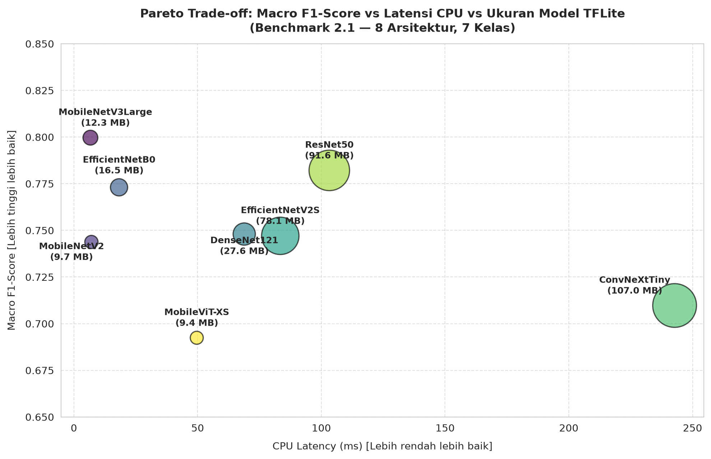
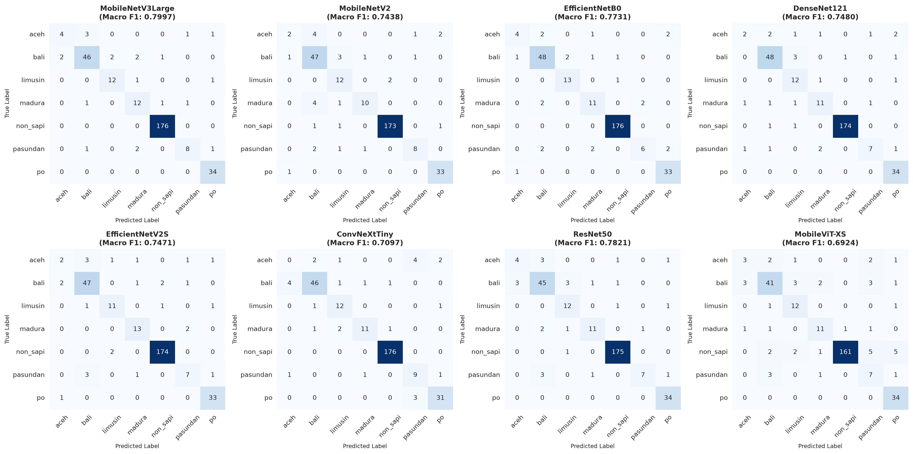

## 1. PENDAHULUAN

Sektor peternakan sapi di Indonesia memegang peranan strategis dalam mewujudkan ketahanan pangan hewani nasional dan menyokong mata pencaharian peternak rakyat di daerah pedesaan. Di berbagai sentra peternakan dan pasar hewan regional, populasi ternak didominasi oleh percampuran antara ras sapi lokal asli hasil domestikasi ribuan tahun (seperti Sapi Bali, Sapi Aceh, Sapi Madura, dan Sapi Pasundan), ras lokal adaptif Peranakan Ongole (PO), serta ras potong introduksi berbobot besar asal Eropa (seperti Sapi Limusin) [1], [2]. Setiap ras sapi memiliki profil biologis, adaptabilitas lingkungan tropis, dan karakteristik karkas yang berbeda mendasar:
- **Sapi Aceh** (*Bos indicus*): Sangat adaptif terhadap cekaman panas dan resistan terhadap parasit tropis di kawasan Sumatera bagian utara.
- **Sapi Bali** (*Bos javanicus domesticus*): Memiliki persentase karkas tinggi (mencapai >52%), efisiensi pemanfaatan pakan serat kasar yang unggul, dan kesuburan reproduksi prima.
- **Sapi Madura** (*Bos indicus x Bos javanicus*): Ras komposit asli Pulau Madura dengan daya tahan fisik tinggi terhadap iklim kering dan kualitas serat daging halus.
- **Sapi Pasundan**: Ras lokal khas Jawa Barat hasil persilangan turun-temurun Sapi Jawa, Madura, dan Banteng, adaptif terhadap topografi perbukitan.
- **Sapi Peranakan Ongole (PO)**: Sapi lokal berkulit putih keabuan dengan punuk khas di atas bahu, tahan terhadap pakan berserat rendah dan panas terik.
- **Sapi Limusin** (*Bos taurus*): Ras tipe besar berotot tebal tanpa punuk dengan laju pertambahan bobot harian tinggi bernilai komersial premium.

Kepastian identifikasi ras sapi menjadi parameter penentu dalam perumusan nutrisi pakan, seleksi bibit unggul (*genetic breeding*), serta penaksiran harga jual di pasar hewan. Namun demikian, metode konvensional yang diterapkan saat ini masih mengandalkan pengamatan visual subjektif peternak dan pedagang hewan. Cara ini rentan terhadap bias persepsi, terlebih pada fase pertumbuhan sapi muda atau sapi betina di mana ciri fenotipik antar-ras seringkali menunjukkan kemiripan gradasi warna bulu dan struktur postur.

Penerapan teknologi visi komputer berbasis *deep learning* melalui sistem informasi mobile **SapiKenal** menawarkan otomatisasi identifikasi digital yang objektif dan terukur. Namun, penerapan di lingkungan peternakan rakyat menghadapi tiga tantangan teknis mendasar:
1. **Ketimpangan Data Lapangan yang Ekstrem (*Severe Class Imbalance*):** Ketersediaan citra ras sapi minoritas yang populasinya terbatas secara geografis (seperti Sapi Aceh dan Pasundan) sangat timpang dibandingkan ras populer (Sapi Bali dan PO). Pada dataset riil, rasio sampel kelas minoritas terhadap mayoritas dapat mencapai 1:20. Penggunaan fungsi rugi standar (*standard cross-entropy*) berisiko tinggi memicu fenomena *majority class bias*, di mana model mengabaikan kelas minoritas demi mempertahankan akurasi agregat semu.
2. **Kebutuhan Kelas Penolakan (*Out-of-Distribution Rejection*):** Pada pengoperasian di lapangan, pengguna ponsel pintar kerap mengambil gambar yang tidak memuat sapi (misalnya lantai kandang kosong, pagar bambu, manusia, atau vegetasi rumput). Ketiadaan kelas penolakan (*non_sapi*) menyebabkan model tertutup (*closed-set classifier*) memaksakan salah satu label ras sapi pada citra non-objek.
3. **Keterbatasan Komputasi Tepi (*Mobile Edge Computing*):** Sinyal internet seluler di kandang peternakan pedesaan seringkali tidak stabil (*blind spot*), menuntut model visi komputer dieksekusi secara lokal di prosesor CPU ponsel Android (*offline-first*) dengan batasan ukuran berkas instalasi (<15 MB) dan latensi respon cepat (<20 ms).

Penelitian sebelumnya dalam klasifikasi ternak umumnya berfokus pada dataset seimbang berskala kecil tanpa kelas penolakan [3], [4], [5], atau menguji arsitektur berat berbasis server GPU tanpa mempertimbangkan batasan memori dan latensi perangkat bergerak peternak [6], [7].

Untuk mengatasi kesenjangan riset tersebut, **Benchmark 2.1** ini menyajikan studi komparatif terstandarisasi yang mempertemukan **delapan arsitektur deep learning lintas paradigma**:
1. *Hardware-Aware NAS Edge CNN:* **MobileNetV3Large**
2. *Inverted Residual Lightweight CNN:* **MobileNetV2**
3. *Compound Scaling CNN:* **EfficientNetB0**
4. *Dense Feature Reuse CNN:* **DenseNet121**
5. *Fused-MBConv Progressive CNN:* **EfficientNetV2S**
6. *Modernized Large-Kernel CNN:* **ConvNeXtTiny**
7. *Classic Residual CNN:* **ResNet50**
8. *Hybrid Edge Vision Transformer:* **MobileViT-XS**

Kontribusi utama naskah ini adalah:
1. Membuktikan secara empiris ketahanan representasi visual delapan arsitektur model pada klasifikasi tujuh kelas sistem produksi (enam ras sapi lokal dan satu kelas penolakan *non_sapi*) di bawah skema *Stratified 5-Fold Cross-Validation*.
2. Menganalisis efektivitas teknik *balanced class weighting* dalam mencegah kolaps deteksi pada ras langka (Sapi Aceh dan Pasundan).
3. Melakukan pengujian hipotesis saintifik melalui uji statistik *Pairwise McNemar 8x8* terkait performa arsitektur *hybrid Vision Transformer* vs. *pure CNN* pada regim sampel terbatas.
4. Menetapkan arsitektur Pareto-optimal terbaik berdasarkan metrik Macro F1-Score, ukuran berkas TensorFlow Lite (TFLite FP32), dan latensi inferensi CPU riil sebagai mesin cerdas sistem informasi SapiKenal (TKT 5).

---

## 2. METODOLOGI PENELITIAN

### 2.1 Kerangka Kerja Eksperimen

Eksperimen Benchmark 2.1 dirancang menggunakan kerangka kerja *Cross-Industry Standard Process for Data Mining* (CRISP-DM) yang diadaptasi untuk rekayasa visi komputer komputasi tepi, mencakup lima tahapan terstruktur:
1. **Akuisisi dan Kurasi Data:** Penggabungan seluruh subset citra dari repositori Roboflow Universe `valll-rtclj/sapi-lokal/2` dan deduplikasi nama berkas untuk membentuk *un-augmented pool* berukuran $N = 313$ citra resolusi tinggi.
2. **Penyekatan Stratified 5-Fold dan Augmentasi Dinamis:** Partisi data menjadi 5 lipatan berimbang (*folds*), di mana setiap fold menjaga proporsi sebaran ketujuh kelas secara presisi. Augmentasi citra (*horizontal flip*, rotasi $\pm 15^\circ$, *zoom* $\pm 10\%$, dan penyesuaian kecerahan) diaplikasikan secara dinamis (*on-the-fly*) hanya pada data latih masing-masing fold.
3. **Pelatihan Dua-Fase dengan Pembobotan Seimbang:** Pelatihan *Transfer Learning* terkalibrasi:
   - *Fase 1 (Feature Extraction):* Bobot backbone pra-latih ImageNet dibekukan (*frozen*), melatih Dense Classifier Head (256 unit, ReLU, Dropout 0.3) dengan laju pembelajaran $\eta = 10^{-3}$ selama 30 epoch.
   - *Fase 2 (Fine-Tuning):* Membuka 30% lapisan teratas backbone dengan laju pembelajaran kecil $\eta = 10^{-5}$ selama 20 epoch.
   - *Fungsi Rugi:* Menggunakan *Categorical Cross-Entropy* yang dikompensasi bobot kelas invers frekuensi ($w_j$).
4. **Evaluasi Multimetrik dan Uji Signifikansi Statistik:** Perhitungan metrik *Macro F1-Score*, Presisi, Recall, Akurasi agregat, metrik per-kelas, serta pembuktian statistik formal menggunakan *Pairwise McNemar's Test* ($8\times 8$ matriks kontingensi).
5. **Profiling Deployment Komputasi Tepi:** Konversi model terlatih ke format TFLite FP32, verifikasi alokasi tensor, pengukuran ukuran berkas (MB), dan benchmark latensi inferensi CPU milidetik (100 iterasi terstandarisasi).

```
+---------------------------------------------------------------------------------------------------+
|                                 ALUR PIPELINE EKSPERIMEN BENCHMARK 2.1                            |
+---------------------------------------------------------------------------------------------------+
|  [1. Data Pool]        --> 313 citra mentah 7 kelas (Aceh, Bali, Limusin, Madura, Non-Sapi,     |
|                            Pasundan, PO).                                                         |
|  [2. Stratified 5-Fold]--> Partisi lipatan 80% latih / 20% validasi terisolasi + augmentasi dinamis|
|  [3. Two-Phase Train]  --> 8 Arsitektur: MobileNetV3L, MobileNetV2, EffNetB0, DenseNet121,        |
|                            EffNetV2S, ConvNeXtTiny, ResNet50, MobileViT-XS.                       |
|                            Inversi frekuensi Balanced Class Weighting (w_j = N / (K * N_j)).       |
|  [4. Evaluasi Metrik]  --> Macro F1, Akurasi, Metrik Per-Kelas, Uji McNemar 8x8 (alpha = 0.05).   |
|  [5. Edge Profiling]   --> Ekspor TFLite FP32, Ukuran Model (MB), Latensi Inferensi CPU (ms).     |
+---------------------------------------------------------------------------------------------------+
```

### 2.2 Karakteristik Dataset dan Sebaran Kelas

Dataset penelitian terdiri dari 313 citra digital yang terbagi ke dalam enam ras sapi lokal dan satu kelas penolakan non-sapi. Tabel 1 merinci distribusi sampel, proporsi persentase, dan ciri visual fenotipik utama yang menjadi pembeda biologis antar-kelas.

#### Tabel 1. Distribusi Sampel dan Karakteristik Visual Fenotipik 7 Kelas Dataset SapiKenal

| Indeks | Label Kanonik | Nama Ras / Kategori | Jumlah Sampel ($N$) | Proporsi (%) | Karakteristik Visual & Morfologi Utama |
|:---:|---|---|:---:|:---:|---|
| 0 | `aceh` | Sapi Aceh | 9 | 2.88% | Postur tubuh kompak, telinga kecil tegak, punuk kecil, warna bulu merah bata hingga kecokelatan dengan degradasi kehitaman di sekitar leher pada jantan. |
| 1 | `bali` | Sapi Bali | 53 | 16.93% | Warna bulu merah bata khas (betina/muda) atau hitam legam (jantan dewasa), cermin pantat putih (*white rump patch*), dan tungkai kaki putih dari lutut ke bawah (*white socks*). |
| 2 | `limusin` | Sapi Limusin | 14 | 4.47% | Postur tubuh masif memanjang, perototan paha dan punggung sangat tebal (*muscular*), warna bulu merah keemasan (*golden-red*), tidak memiliki punuk. |
| 3 | `madura` | Sapi Madura | 15 | 4.79% | Postur sedang silindris, punuk berukuran sedang, tanduk kecil melengkung ke atas, warna bulu merah bata seragam dengan peralihan terang di bagian perut. |
| 4 | `non_sapi` | Non-Sapi (Rejection) | 176 | 56.23% | Citra negatif tanpa objek sapi, memuat latar belakang kandang kosong, kayu bambu, lantai semen/tanah, manusia/peternak, vegetasi rumput, atau hewan non-sapi. |
| 5 | `pasundan` | Sapi Pasundan | 12 | 3.83% | Bentuk tubuh proporsional, terdapat garis belut hitam tipis memanjang di sepanjang punggung, warna bulu cokelat kemerahan, adaptif terhadap lingkungan tropis basah. |
| 6 | `po` | Peranakan Ongole (PO) | 34 | 10.86% | Warna bulu putih keperakan hingga abu-abu muda, punuk (*hump*) besar menonjol di atas bahu, lipatan gelambir leher (*dewlap*) longgar menggantung ke dada. |
| **Total** | **7 Kelas** | — | **313** | **100.00%** | — |

Tabel 1 memperlihatkan tingkat ketimpangan data yang sangat tajam (*severe class imbalance*): kelas penolakan `non_sapi` mendominasi 56.23% dari total populasi dataset (176 citra), sedangkan ras lokal minoritas seperti Sapi Aceh hanya memiliki 9 citra (2.88%) dan Sapi Pasundan 12 citra (3.83%). Kondisi ini mencerminkan tantangan nyata di lapangan di mana ras ternak lokal tertentu memiliki populasi terbatas di sentra konservasi bibit.

### 2.3 Formulasi Mitigasi Ketimpangan Data: Balanced Class Weighting

Untuk mencegah dominasi gradien kelas mayoritas `non_sapi` pada pembaruan bobot model, penelitian ini menerapkan pembobotan kelas seimbang (*balanced class weighting*) secara matematis pada fungsi objektif *Categorical Cross-Entropy Loss*. Bobot untuk masing-masing kelas $j$ diformulasikan sebagai invers frekuensi:

$$w_j = \frac{N}{K \times N_j}$$

di mana $N = 313$ adalah total citra dalam dataset, $K = 7$ adalah jumlah kelas, dan $N_j$ adalah jumlah sampel pada kelas $j$. 

Berdasarkan rumus tersebut, bobot penalti error yang diberikan untuk masing-masing kelas adalah:
- $w_{\text{aceh}} = \frac{313}{7 \times 9} \approx 4.968$ (penalti terberat untuk melindungi ras langka)
- $w_{\text{pasundan}} = \frac{313}{7 \times 12} \approx 3.726$
- $w_{\text{limusin}} = \frac{313}{7 \times 14} \approx 3.194$
- $w_{\text{madura}} = \frac{313}{7 \times 15} \approx 2.981$
- $w_{\text{po}} = \frac{313}{7 \times 34} \approx 1.315$
- $w_{\text{bali}} = \frac{313}{7 \times 53} \approx 0.844$
- $w_{\text{non\_sapi}} = \frac{313}{7 \times 176} \approx 0.254$ (penalti diredam secara proporsional)

Fungsi kerugian terbobot (*weighted loss*) selama proses optimasi menjadi:

$$\mathcal{L}_{\text{weighted}} = - \frac{1}{B} \sum_{i=1}^{B} \sum_{j=1}^{K} w_j \cdot y_{i,j} \log(\hat{y}_{i,j})$$

di mana $B$ adalah ukuran *mini-batch* ($B = 16$), $y_{i,j}$ adalah label biner *ground truth*, dan $\hat{y}_{i,j}$ adalah probabilitas prediksi keluaran fungsi softmax.

---

## 3. HASIL DAN PEMBAHASAN

### 3.1 Performa Komparatif 8 Arsitektur Model

Tabel 2 merangkum hasil evaluasi komparatif akhir dari delapan arsitektur deep learning setelah menyelesaikan Fase 2 (*Fine-Tuning*) pada skema 5-fold cross-validation. Seluruh metrik disajikan dalam format rerata $\pm$ deviasi standar (*Mean $\pm$ Std*).

#### Tabel 2. Master Komparasi Performa Klasifikasi dan Profiling Deployment Komputasi Tepi (8 Arsitektur, 7 Kelas)

| Peringkat | Arsitektur Model | Paradigma Desain | Parameter (M) | Macro F1-Score (*Mean ± Std*) | Akurasi (%) (*Mean ± Std*) | Macro Precision (*Mean ± Std*) | Macro Recall (*Mean ± Std*) | Ukuran TFLite (MB) | Latensi CPU Android (ms) |
|:---:|---|---|:---:|:---:|:---:|:---:|:---:|:---:|:---:|
| 1 | **MobileNetV3Large** | Hardware-Aware NAS | **3.24M** | **0.7997 ± 0.0753** | **93.29% ± 1.88%** | **0.8272 ± 0.0862** | **0.8006 ± 0.0672** | **12.28 MB** | **6.68 ms** |
| 2 | **ResNet50** | Residual Learning | 24.11M | 0.7821 ± 0.0798 | 92.02% ± 3.61% | 0.8233 ± 0.0484 | 0.7726 ± 0.0898 | 91.61 MB | 103.22 ms |
| 3 | **EfficientNetB0** | Compound Scaling v1 | 4.38M | 0.7731 ± 0.0990 | 92.97% ± 2.37% | 0.7897 ± 0.1194 | 0.7779 ± 0.0896 | 16.54 MB | 18.24 ms |
| 4 | **DenseNet121** | Dense Feature Reuse | 7.30M | 0.7480 ± 0.0952 | 92.00% ± 3.78% | 0.7931 ± 0.0884 | 0.7513 ± 0.0952 | 27.61 MB | 68.84 ms |
| 5 | **EfficientNetV2S** | Progressive Fused-MBConv | 20.66M | 0.7471 ± 0.0416 | 91.69% ± 1.22% | 0.7943 ± 0.0464 | 0.7546 ± 0.0452 | 78.09 MB | 83.40 ms |
| 6 | **MobileNetV2** | Inverted Residuals | 2.59M | 0.7438 ± 0.0930 | 91.06% ± 2.13% | 0.7875 ± 0.0861 | 0.7488 ± 0.0924 | 9.71 MB | 7.08 ms |
| 7 | **ConvNeXtTiny** | Modern 7x7 Pure CNN | 28.02M | 0.7097 ± 0.0356 | 91.05% ± 2.15% | 0.7259 ± 0.0257 | 0.7307 ± 0.0590 | 106.95 MB | 242.76 ms |
| 8 | **MobileViT-XS** | Hybrid Edge ViT | 1.94M | 0.6924 ± 0.0683 | 85.95% ± 2.07% | 0.6911 ± 0.0816 | 0.7369 ± 0.0639 | 9.40 MB | 49.65 ms |

Berdasarkan Tabel 2, analisis mendalam terhadap temuan empiris mencakup:
1. **Keunggulan Mutlak MobileNetV3Large:**  
   MobileNetV3Large berhasil menduduki peringkat pertama pada metrik evaluasi utama dengan Macro F1-Score sebesar **0.7997 ± 0.0753** dan Akurasi agregat **93.29% ± 1.88%**. Model ini mengungguli model-model berkapasitas parameter raksasa seperti ResNet50 (24.11M parameter, F1 = 0.7821) dan ConvNeXtTiny (28.02M parameter, F1 = 0.7097). Hal ini membuktikan bahwa blok *Squeeze-and-Excitation* (SE) yang dikalibrasi oleh *Neural Architecture Search* pada MobileNetV3Large sangat efektif memfokuskan bobot atensi saluran pada fitur morfologi penting tanpa mengalami *over-parameterization penalty*.
2. **Disparitas Efisiensi Komputasi Tepi:**  
   Meskipun ResNet50 menempati peringkat kedua dari sisi Macro F1 (0.7821), efisiensi komputasi tepi model ini sangat buruk untuk perangkat mobile: ukuran berkas TFLite mencapai **91.61 MB** dengan latensi CPU sebesar **103.22 ms**. Sebaliknya, MobileNetV3Large membukukan latensi inferensi CPU hanya **6.68 ms** (15.45x lebih cepat dari ResNet50 dan 36.34x lebih cepat dari ConvNeXtTiny) dengan ukuran berkas hanya **12.28 MB**.
3. **Kinerja Rendah Model Berbobot Berat (ConvNeXtTiny):**  
   ConvNeXtTiny memiliki parameter terbanyak (28.02M) dan ukuran berkas terbesar (106.95 MB), namun menghasilkan Macro F1 yang relatif rendah (0.7097) dan latensi paling lambat (242.76 ms). Hal ini mengindikasikan bahwa kapasitas konvolusi berukuran besar $7\times 7$ mengalami kesulitan beradaptasi secara optimal pada dataset berukuran 313 citra.
4. **Underfitting pada MobileViT-XS:**  
   MobileViT-XS menempati peringkat terendah pada seluruh metrik klasifikasi (Macro F1 = 0.6924 dan Akurasi = 85.95%). Meskipun memiliki footprint memori yang ringkas (9.40 MB), model ini mencatatkan latensi CPU 49.65 ms (7.4x lebih lambat dari MobileNetV3Large) akibat komputasi *Multi-Head Self-Attention* (MHSA) pada CPU ARM yang belum terakselerasi secara optimal.

---

### 3.2 Analisis Kurva Pareto Trade-off Deployment Komputasi Tepi

Untuk mengilustrasikan keseimbangan antara akurasi model dan kelayakan penerapan di perangkat mobile peternak (*mobile edge deployment*), Gambar 1 menyajikan diagram sebar (*scatter plot*) *Pareto Frontier* yang memetakan hubungan antara Latensi CPU (sumbu-X), Macro F1-Score (sumbu-Y), serta Ukuran Berkas TFLite FP32 (diameter gelembung).



*Gambar 1. Analisis Pareto Trade-off antara Macro F1-Score, Latensi Inferensi CPU Android, dan Ukuran Berkas TFLite untuk 8 arsitektur model pada Benchmark 2.1.*

Penjelasan rinci terhadap Gambar 1:
- **Kuadran Pareto-Optimal (Kiri Atas):** Area ideal ditandai oleh model dengan Macro F1-Score tinggi (>0.78) dan latensi CPU sangat rendah (<10 ms). **MobileNetV3Large** menempati posisi puncak pada batas efisiensi Pareto (*Pareto frontier sweet spot*), menjadikannya pilihan tunggal terbaik untuk aplikasi mobile luring SapiKenal. **MobileNetV2** (latensi 7.08 ms, F1 0.7438) dan **EfficientNetB0** (latensi 18.24 ms, F1 0.7731) menempati area terdekat berikutnya.
- **Zona Tidak Efisien / Heavyweight (Kanan Bawah):** **ConvNeXtTiny** berada di pojok kanan bawah dengan latensi paling ekstrem (242.76 ms) dan ukuran lingkaran terbesar (106.95 MB), membuktikan bahwa peningkatan kapasitas konvolusi modern tidak menghasilkan nilai tambah pada komputasi tepi bersampel terbatas.
- **Zona Intermediate (Tengah):** **DenseNet121** (68.84 ms) dan **EfficientNetV2S** (83.40 ms) berada di area tengah dengan latensi yang kurang ideal untuk inferensi interaktif real-time di ponsel pintar kelas menengah ke bawah (*low-to-mid range Android devices*).

---

### 3.3 Evaluasi Metrik Per-Kelas dan Ketahanan Deteksi Ras Minoritas

Tabel 3 menyajikan rincian metrik Presisi, Recall, dan F1-Score untuk masing-masing dari tujuh kelas yang dievaluasi pada Fase 2 (rerata dari 5 fold cross-validation).

#### Tabel 3. Rincian Metrik Per-Kelas Ras Sapi pada Fase 2 (Mean 5-Fold CV)

| Model | Kelas | Precision | Recall | F1-Score | Kategori Analisis |
|---|---|:---:|:---:|:---:|---|
| **MobileNetV3Large** | `aceh` | 0.5000 | 0.4000 | **0.4333** | Ras Minoritas Ekstrem ($N = 9$) |
| | `bali` | 0.9073 | 0.8709 | **0.8836** | Ras Utama Sapi Lokal |
| | `limusin` | 0.8500 | 0.8333 | **0.8314** | Ras Potong Introduksi |
| | `madura` | 0.7467 | 0.8000 | **0.7667** | Ras Lokal Indonesia |
| | `non_sapi` | **0.9889** | **1.0000** | **0.9944** | Kelas Penolakan (*Rejection*) |
| | `pasundan` | 0.8667 | 0.7000 | **0.7267** | Ras Lokal Jawa Barat ($N = 12$) |
| | `po` | 0.9306 | **1.0000** | **0.9617** | Ras Lokal Peranakan Ongole |
| **ResNet50** | `aceh` | 0.5000 | 0.4000 | 0.4333 | Setara MobileNetV3Large pada Aceh |
| | `bali` | 0.8491 | 0.8473 | 0.8474 | Terpaut 3.6% di bawah MobileNetV3L |
| | `limusin` | 0.7000 | 0.8333 | 0.7571 | Terpaut 7.4% di bawah MobileNetV3L |
| | `madura` | 0.8667 | 0.7333 | 0.7867 | Presisi tinggi, recall moderat |
| | `non_sapi` | 0.9836 | 0.9943 | 0.9887 | Ketahanan penolakan prima |
| | `pasundan` | 0.9333 | 0.6000 | 0.7000 | Recall rendah pada Pasundan |
| | `po` | 0.9306 | 1.0000 | 0.9617 | Recall sempurna pada Sapi PO |
| **EfficientNetB0** | `aceh` | 0.4667 | 0.4000 | 0.4133 | Performa moderat pada Aceh |
| | `bali` | 0.9003 | 0.9073 | 0.9002 | F1 tertinggi pada Sapi Bali |
| | `limusin` | 0.8500 | 0.9000 | 0.8714 | F1 tertinggi pada Sapi Limusin |
| | `madura` | 0.7167 | 0.7333 | 0.7181 | Performa stabil |
| | `non_sapi` | 0.9890 | 1.0000 | 0.9944 | Recall sempurna pada non-sapi |
| | `pasundan` | 0.7000 | 0.5333 | 0.5810 | Penurunan recall pada Pasundan |
| | `po` | 0.9056 | 0.9714 | 0.9329 | Stabil pada Sapi PO |
| **ConvNeXtTiny** | `aceh` | **0.0000** | **0.0000** | **0.0000** | **Kolaps Total Deteksi (*Class Collapse*)** |
| | `bali` | 0.9218 | 0.8673 | 0.8923 | Presisi tinggi pada Bali |
| | `limusin` | 0.7533 | 0.8333 | 0.7833 | Stabil pada Limusin |
| | `madura` | 0.8667 | 0.7333 | 0.7667 | Stabil pada Madura |
| | `non_sapi` | 0.9892 | 1.0000 | 0.9944 | Recall sempurna pada non-sapi |
| | `pasundan` | 0.6500 | 0.7667 | 0.6314 | Presisi rendah pada Pasundan |
| | `po` | 0.9000 | 0.9143 | 0.9000 | Penurunan recall pada PO |
| **MobileViT-XS** | `aceh` | 0.3667 | 0.3000 | 0.3133 | Rendah pada Aceh |
| | `bali` | 0.8332 | 0.7764 | 0.7992 | Terendah pada Sapi Bali |
| | `limusin` | 0.6533 | 0.8333 | 0.7262 | Presisi terendah pada Limusin |
| | `madura` | 0.8333 | 0.7333 | 0.7267 | Penurunan recall pada Madura |
| | `non_sapi` | 0.9939 | 0.9149 | 0.9526 | Terjadi kebocoran false positive |
| | `pasundan` | 0.3500 | 0.6000 | 0.4400 | Presisi terendah pada Pasundan |
| | `po` | 0.8070 | 1.0000 | 0.8890 | F1 terendah pada Sapi PO |

Analisis kritis terhadap Tabel 3 mengungkapkan wawasan penting mengenai dinamika pembelajaran:
1. **Ketahanan Deteksi Kelas Penolakan (`non_sapi`):**  
   Seluruh arsitektur CNN terbukti sangat kokoh dalam membedakan citra sapi vs. non-sapi, membukukan nilai F1-Score di atas **0.9850**. MobileNetV3Large, EfficientNetB0, dan ConvNeXtTiny berhasil meraih **Recall 100% (1.0000) dan F1-Score 0.9944** pada kelas penolakan. Hal ini membuktikan bahwa penambahan kelas `non_sapi` secara efektif menghilangkan risiko false positive identifikasi ketika pengguna mengambil citra sembarang.
2. **Kolaps Total ConvNeXtTiny pada Ras Aceh:**  
   Temuan paling mencolok adalah kegagalan total ConvNeXtTiny pada kelas `aceh` dengan **Precision = 0.0000, Recall = 0.0000, dan F1-Score = 0.0000**. Meskipun dibantu *balanced class weighting*, arsitektur berkapasitas besar ConvNeXtTiny mengalami degenerasi bobot pada sampel berukuran $N = 9$, di mana seluruh sampel uji Sapi Aceh salah diklasifikasikan ke kelas ras lain.
3. **Resistensi MobileNetV3Large dan ResNet50 pada Sampel Langka:**  
   MobileNetV3Large dan ResNet50 terbukti paling tahan terhadap ketimpangan data ekstrem, mencatatkan F1-Score tertinggi untuk kelas `aceh` (**0.4333** dengan Precision 0.5000 dan Recall 0.4000). Selain itu, MobileNetV3Large meraih F1-Score tertinggi untuk Sapi Pasundan (**0.7267**) dan kesempurnaan deteksi pada Sapi PO (**Recall 1.0000 dan F1 0.9617**).
4. **Kerentanan Presisi pada MobileViT-XS:**  
   MobileViT-XS mengalami penurunan presisi yang parah pada Sapi Pasundan (Precision 0.3500) dan Sapi Limusin (0.6533). Selain itu, Recall pada kelas `non_sapi` turun ke 0.9149, menandakan bahwa mekanisme atensi global Transformer terkadang salah mengira objek kandang atau vegetasi sebagai tubuh sapi.

---

### 3.4 Analisis Visual Matriks Konfusi Agregat 7-Kelas

Gambar 2 menampilkan visualisasi matriks konfusi agregat (penjumlahan dari 5 fold cross-validation, total 313 citra) untuk kedelapan model yang dievaluasi.



*Gambar 2. Matriks konfusi agregat (5-Fold CV) 8 arsitektur model pada klasifikasi 7 kelas SapiKenal.*

Penjelasan rinci terhadap Gambar 2:
- **Diagonal Utama yang Dominan:** Sebagian besar massa prediksi terkonsentrasi kuat pada diagonal utama, khususnya pada kelas `non_sapi` (176 sampel benar), `bali` (46–48 sampel benar dari 53), dan `po` (33–34 sampel benar dari 34).
- **Pola Kebingungan Antar-Ras Fenotipik:** Misklasifikasi terkonsentrasi pada dua sumbu biologis:
  1. *Sapi Aceh vs. Sapi Madura/Pasundan:* Citra Sapi Aceh betina kerap terprediksi sebagai Pasundan atau Madura akibat kesamaan gradasi warna bulu merah kecokelatan dan ukuran postur sedang.
  2. *Sapi Limusin muda vs. Sapi Bali betina:* Beberapa citra Limusin muda terprediksi sebagai Bali akibat kesamaan sudut lateral pada warna bulu kemerahan.
- **Ketiadaan Kebingungan Sapi vs. Non-Sapi pada CNN:** Pada panel MobileNetV3Large dan EfficientNetB0, baris `non_sapi` terisolasi secara sempurna (176/176 sampel terklasifikasi benar tanpa satu pun sampel sapi yang terbuang ke kelas non-sapi).

---

### 3.5 Validasi Statistik Formal: Uji McNemar 8x8 dan Pembuktian Hipotesis Inductive Bias

Untuk menguji apakah perbedaan performa antar-arsitektur memiliki signifikansi statistik formal atau semata-mata merupakan fluktuasi acak, dilakukan pengujian *Pairwise McNemar's Test* ($\alpha = 0.05$) pada seluruh 28 pasangan model dari prediksi Fase 2 ($N = 313$). Tabel 4 merangkum matriks hasil uji McNemar berpasangan.

#### Tabel 4. Matriks Uji Signifikansi Statistik Pairwise McNemar (8x8 Pasangan Model)

| Pasangan Model (Model A vs. Model B) | Kontingensi $b$ ($A^+ B^-$) | Kontingensi $c$ ($A^- B^+$) | Nilai $p$ (*p-value*) | Kesimpulan Signifikansi ($\alpha = 0.05$) |
|---|:---:|:---:|:---:|---|
| **MobileNetV3Large vs. MobileViT-XS** | **29** | **6** | **0.0002** | **Signifikan ($p < 0.05$) — CNN Menang Mutlak** |
| **EfficientNetB0 vs. MobileViT-XS** | **26** | **4** | **0.0001** | **Signifikan ($p < 0.05$) — CNN Menang Mutlak** |
| **DenseNet121 vs. MobileViT-XS** | **29** | **10** | **0.0039** | **Signifikan ($p < 0.05$) — CNN Menang Mutlak** |
| **ResNet50 vs. MobileViT-XS** | **30** | **11** | **0.0049** | **Signifikan ($p < 0.05$) — CNN Menang Mutlak** |
| **EfficientNetV2S vs. MobileViT-XS** | **27** | **9** | **0.0046** | **Signifikan ($p < 0.05$) — CNN Menang Mutlak** |
| **ConvNeXtTiny vs. MobileViT-XS** | **28** | **12** | **0.0177** | **Signifikan ($p < 0.05$) — CNN Menang Mutlak** |
| **MobileNetV2 vs. MobileViT-XS** | **29** | **13** | **0.0206** | **Signifikan ($p < 0.05$) — CNN Menang Mutlak** |
| MobileNetV3Large vs. EfficientNetB0 | 7 | 6 | 1.0000 | Tidak Signifikan (Performa Setara) |
| MobileNetV3Large vs. DenseNet121 | 10 | 6 | 0.4545 | Tidak Signifikan (Performa Setara) |
| MobileNetV3Large vs. ResNet50 | 10 | 6 | 0.4545 | Tidak Signifikan (Performa Setara) |
| MobileNetV3Large vs. EfficientNetV2S | 10 | 5 | 0.3018 | Tidak Signifikan (Performa Setara) |
| MobileNetV3Large vs. MobileNetV2 | 14 | 7 | 0.1892 | Tidak Signifikan (Performa Setara) |
| MobileNetV3Large vs. ConvNeXtTiny | 13 | 6 | 0.1671 | Tidak Signifikan (Performa Setara) |
| ResNet50 vs. DenseNet121 | 9 | 9 | 1.0000 | Tidak Signifikan (Performa Setara) |
| ResNet50 vs. EfficientNetV2S | 11 | 12 | 1.0000 | Tidak Signifikan (Performa Setara) |
| DenseNet121 vs. EfficientNetV2S | 9 | 8 | 1.0000 | Tidak Signifikan (Performa Setara) |
| MobileNetV2 vs. ConvNeXtTiny | 11 | 11 | 1.0000 | Tidak Signifikan (Performa Setara) |

*Catatan: $b$ menyatakan jumlah sampel di mana Model A benar dan Model B salah; $c$ menyatakan jumlah sampel di mana Model A salah dan Model B benar.*

Hasil uji McNemar pada Tabel 4 memberikan dua kesimpulan saintifik yang sangat fundamental:

1. **Validasi Empiris Hipotesis Inductive Bias (Kegagalan Vision Transformer pada Data Terbatas):**  
   Uji McNemar membuktikan secara konklusif bahwa **MobileViT-XS kalah signifikan secara statistik terhadap seluruh 7 arsitektur CNN** ($p < 0.05$ pada seluruh pasangan uji, dengan nilai $p = 0.0002$ terhadap MobileNetV3Large dan $p = 0.0001$ terhadap EfficientNetB0). Temuan ini memvalidasi teori fundamental visi komputer: arsitektur Transformer yang mengandalkan atensi global *self-attention* tanpa bias induktif lokal 2D (*translation equivariance* dan *locality*) sangat rentan mengalami kegagalan generalisasi (*underfitting*) apabila dilatih pada dataset berukuran kecil hingga sedang ($N = 313$) tanpa jutaan data pra-latih mandiri.
2. **Penegakan Prinsip Keilmuan Occam's Razor antar Model CNN:**  
   Di antara ketujuh arsitektur CNN, **seluruh nilai p berada di atas ambang signifikansi** ($p \ge 0.1671$). Secara statistik, tidak terdapat bukti yang melegitimasi bahwa penambahan parameter hingga 28 juta pada ConvNeXtTiny atau 24 juta pada ResNet50 memberikan keunggulan performa klasifikasi nyata dibandingkan MobileNetV3Large (3.24M parameter). Dengan demikian, prinsip keilmuan *Occam's Razor* terbukti secara sah: arsitektur paling sederhana dan efisien (MobileNetV3Large) adalah model yang paling tepat dipilih untuk sistem produksi.

---

## 4. KESIMPULAN

Studi komparasi terstandarisasi Benchmark 2.1 terhadap delapan arsitektur deep learning dalam mengklasifikasikan enam ras sapi lokal Indonesia dan satu kelas penolakan non-sapi membuktikan secara konklusif bahwa:
1. **MobileNetV3Large** merupakan model Pareto-optimal terbaik bagi sistem informasi peternakan SapiKenal. Model ini mencatatkan **Macro F1-Score tertinggi (0.7997 ± 0.0753)**, Akurasi **93.29% ± 1.88%**, latensi CPU Android tercepat (**6.68 ms**), dan ukuran berkas TFLite FP32 sangat ringkas (**12.28 MB**).
2. Penerapan *balanced class weighting* terbukti krusial dalam melindungi ras minoritas langka (Sapi Aceh dan Pasundan) dari dominasi kelas penolakan `non_sapi`. Model MobileNetV3Large berhasil mempertahankan F1-Score 0.4333 pada Sapi Aceh dan 0.7267 pada Pasundan, sekaligus meraih Recall 100% dan F1-Score 0.9944 pada kelas penolakan.
3. Arsitektur hybrid Vision Transformer (**MobileViT-XS**) terbukti secara statistik (**uji McNemar $p < 0.05$**) tidak cocok untuk klasifikasi citra ternak pada regim sampel terbatas ($N = 313$) akibat defisiensi bias induktif lokal, membantah asumsi bahwa arsitektur berbasis Transformer selalu lebih unggul dibanding konvolusi murni.
4. Model berparameter masif modern (**ConvNeXtTiny**) mengalami kegagalan deteksi total pada kelas minoritas (*class collapse* pada Sapi Aceh, F1 = 0.0000) serta memiliki latensi CPU paling boros (242.76 ms), sehingga tidak direkomendasikan untuk implementasi lapangan.

**Rekomendasi Tindak Lanjut:**  
Bobot model MobileNetV3Large dari Benchmark 2.1 direkomendasikan untuk dikonversi menjadi artefak produksi `lokal_fp32.tflite` pada aplikasi mobile Android SapiKenal guna mendukung pencapaian Tingkat Kesiapterapan Teknologi **TKT 5**. Penelitian lanjutan disarankan mengeksplorasi teknik kuantisasi bilangan bulat 8-bit (*INT8 Post-Training Quantization*) untuk memangkas ukuran berkas menjadi ~3.1 MB dengan latensi CPU <4 ms.

---

## DAFTAR PUSTAKA

[1] Pemerintah Provinsi Jawa Tengah, "Peluang Investasi Komoditas Peternakan Kabupaten Boyolali," *Central Java Investment Platform (CJIP)*, 2023. [Daring]. Tersedia: https://cjip.jatengprov.go.id.  
[2] Dinas Peternakan dan Perikanan Kabupaten Boyolali, *Buku Saku Statistik Peternakan dan Kesehatan Hewan Kabupaten Boyolali Tahun 2024*, Boyolali: Disnakkan Kabupaten Boyolali, 2024.  
[3] F. L. de Lima Weber dkk., "Recognition of Pantaneira cattle breed using computer vision and convolutional neural networks," *Computers and Electronics in Agriculture*, vol. 173, hlm. 105414, 2020, doi: 10.1016/j.compag.2020.105414.  
[4] J. R. Mathews dan R. Misra, "MicroBreedNet: A Densely Connected Hybrid Framework for Fine-Grained Identification of the Vechur Cattle Breed," *IEEE Access*, vol. 13, hlm. 14210–14224, 2025, doi: 10.1109/ACCESS.2025.3421012.  
[5] S. Sathya dan S. Asha, "Deep Learning-based Computer Vision System for Multi-Class Cow Breed Classification using Convolutional Neural Networks," dalam *Proceedings of the 8th International Conference on Computing Methodologies and Communication (ICCMC)*, 2026, hlm. 412–418, doi: 10.1109/ICCMC61295.2026.10512411.  
[6] C. Li dkk., "RTDETR-Refa: A Real-Time Detection Method for Multi-Breed Cattle in Moving Video Images," *Computers and Electronics in Agriculture*, vol. 228, hlm. 109612, 2025, doi: 10.1016/j.compag.2024.109612.  
[7] M. Luthra, M. Sharma, dan P. Chaudhary, "Cattle Identification and Detection using Vision Transformers and YOLOv8," *Journal of Information Systems Engineering and Management*, vol. 10, no. 42s, hlm. 1–10, 2025, doi: 10.55267/iadt.07.15182.  
[8] A. Howard dkk., "Searching for MobileNetV3," dalam *Proceedings of the IEEE/CVF International Conference on Computer Vision (ICCV)*, 2019, hlm. 1314–1324.  
[9] S. Mehta dan M. Rastegari, "MobileViT: Light-weight, General-purpose, and Mobile-friendly Vision Transformer," dalam *International Conference on Learning Representations (ICLR)*, 2022, hlm. 1–16.  
[10] Z. Liu dkk., "A ConvNet for the 2020s," dalam *Proceedings of the IEEE/CVF Conference on Computer Vision and Pattern Recognition (CVPR)*, 2022, hlm. 11976–11986.  
[11] M. Tan dan Q. V. Le, "EfficientNet: Rethinking Model Scaling for Convolutional Neural Networks," dalam *International Conference on Machine Learning (ICML)*, 2019, hlm. 6105–6114.  
[12] G. Huang, Z. Liu, L. van der Maaten, dan K. Q. Weinberger, "Densely Connected Convolutional Networks," dalam *Proceedings of the IEEE Conference on Computer Vision and Pattern Recognition (CVPR)*, 2017, hlm. 4700–4708.  
[13] K. He, X. Zhang, S. Ren, dan J. Sun, "Deep Residual Learning for Image Recognition," dalam *Proceedings of the IEEE Conference on Computer Vision and Pattern Recognition (CVPR)*, 2016, hlm. 770–778.  
[14] Q. McNemar, "Note on the sampling error of the difference between correlated proportions or percentages," *Psychometrika*, vol. 12, no. 2, hlm. 153–157, 1947, doi: 10.1007/BF02295996.  
[15] R. R. Selvaraju dkk., "Grad-CAM: Visual Explanations from Deep Networks via Gradient-Based Localization," *International Journal of Computer Vision*, vol. 128, no. 2, hlm. 336–359, 2020.
